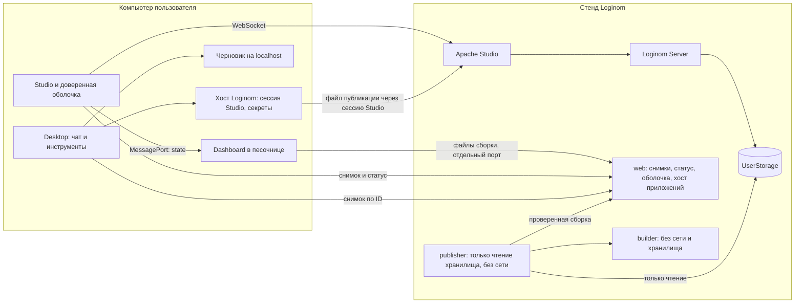

# Документы: архитектура и roadmap dashboard в Loginom

## Что получится

- Главный документ [docs/superpowers/specs/2026-11-11-dashboard-architecture-roadmap.md](docs/superpowers/specs/2026-11-11-dashboard-architecture-roadmap.md).
- Заметка [docs/research/2026-11-11-dashboard-browser-isolation-check.md](docs/research/2026-11-11-dashboard-browser-isolation-check.md) с проверкой плана изоляции по первоисточникам. Заметка по документации Loginom уже есть: [docs/research/2026-11-11-loginom-deployment-for-dashboards.md](docs/research/2026-11-11-loginom-deployment-for-dashboards.md).
- Обновлённый [docs/security/dashboard-isolation.md](docs/security/dashboard-isolation.md). Без обновления он будет противоречить новым решениям: Chromium 152 и отдельный домен в нём обязательны.
- Одна строка со ссылкой в [dashboard/AGENTS.md](dashboard/AGENTS.md). Код не меняется.

Требования к тексту:

- писать подробно, но без воды и повторов;
- каждое понятие объяснять один раз, при первом упоминании, и дальше ссылаться на это место;
- использовать короткие фразы и термины из глоссария;
- в каждом разделе отвечать на три вопроса: что, зачем и как.

## Решения

- **Приоритет стендов.**
  1. Локальный dev-стенд на артефактах сборки Loginom master.
  2. Release-версия Loginom в контейнерах.
  3. Loginom прямо в Linux — **backlog**: архитектура его поддерживает, но скрипт и приёмка будут позже.
- **Хранение и права.**
  - Опубликованный dashboard — это файл рядом с пакетом в UserStorage.
  - Агент кладёт его туда через сессию Studio пользователя. Право записи проверяет сам Loginom.
  - Схема включается только после spike. Если spike не удастся, запасной вариант — приём файла через API стенда по ключу публикации.
  - Резервная копия хранилища и перенос папки сохраняют dashboard. «Сохранить как» и переименование отдельного пакета — нет; инструмент переноса в backlog.
- **Сборка гибридная.**
  - Черновик собирается на компьютере пользователя.
  - Зрители получают только контрольную сборку стенда.
  - Node.js 24.19.0 уже входит в поставку Desktop и CLI: его кладёт [stage-resources.ts](packages/loginom-host/script/stage-resources.ts) для рантайма Loginom. Ставить или скачивать Node не нужно.
  - Набор шаблона (React, Recharts, Vite, TypeScript) тоже входит в поставку: так же, как зависимости рантайма. Без загрузок, работает офлайн.
- **Данные для черновика** — из снимка. Оболочка сама читает порт выполненного узла в сессии пользователя и передаёт небольшую порцию: до 100 строк и 512 КиБ, как у штатного чтения порта.
- **Компоненты dashboard на стенде работают в контейнерах:** один образ, три контейнера.
- **Режимы браузера:**
  - **Обычный (по умолчанию).** Песочница, CSP, заголовок `Connection-Allowlist` отправляется всегда; проверки браузера нет. Хост приложений работает на отдельном порту того же адреса стенда; локально — на `dashboards.localhost`.
  - **Строгий (включается настройкой стенда).** Пускаем только Chromium 152 и новее, с отказом и объяснением для остальных. Хост приложений — на отдельном регистрируемом домене.
- **CLI** нужен только для разработки самого агента. Кнопка «Скопировать команду для CLI» по умолчанию выключена.
- **Переносимость.** Dashboard никогда не меняет `.lgp`. Пакет открывается и работает на стенде без поддержки dashboard; папка `.dashboards` рядом с ним ни на что не влияет.
- **Остаются в силе:**
  - код dashboard недоверенный;
  - параметры меняет только доверенная шапка;
  - агент получает реальные строки;
  - неактивный узел выполняется автоматически при открытии.

## Как это работает для пользователя

Пользователь видит два этапа: **«Черновик»** и **«Публикация»**. Альтернативные названия для первого этапа — «Предпросмотр», «Макет», «Примерка». Владелец выбирает при ревью документа.

### Черновик — по шагам

1. Пользователь нажимает в Studio «Создать dashboard» или «Изменить в чате».
2. Оболочка при необходимости выполняет узел и читает его первый выходной порт.
3. Оболочка отправляет снимок в web-контейнер стенда и получает ID. В снимке: схема, до 100 строк, параметры и имя узла.
4. Desktop открывает deep link `loginom-ai-agent://dashboard?id=…&action=…` и **один раз** забирает снимок с адреса подключённого стенда. Снимок одноразовый и живёт до 15 минут.
5. Desktop кладёт `snapshot.json` и `sample.json` в рабочую папку dashboard в своём профиле. При правке туда же скачиваются текущие исходники со стенда.
6. Над полем ввода появляется надпись «Черновик dashboard для узла X».
7. Агент правит `src/` и вызывает `dashboard_draft`. Инструмент:
   - собирает dashboard встроенным Node;
   - поднимает сервер черновика на `http://localhost:<порт>` (только для этого компьютера);
   - делает быструю самопроверку во встроенном Chromium: страница открылась, ошибок нет;
   - отдаёт ссылку.
8. Страница черновика:
   - доверенная шапка: «Черновик — виден только вам. Данные: пример из N строк от <время>»;
   - параметры видны, но не пересчитываются, и об этом есть подпись;
   - dashboard работает в той же песочнице и с теми же заголовками, что на стенде;
   - после каждой пересборки страница обновляется сама.
9. Пользователь просит правки в чате, пока результат его не устроит. Затем пишет «Опубликовать». Без такого явного согласия агент не публикует.

### Публикация на стенд — по шагам

1. Инструмент `dashboard_publish` пересобирает черновик и проверяет, что в `src/` нет значений из `sample.json` длиной от 6 символов. Так данные не вшиваются в код.
2. Инструмент собирает **один файл публикации** — JSON до 1 МБ. В нём:
   - версия формата;
   - привязка: путь пакета, GUID workflow и GUID узла;
   - заголовок и подписи параметров;
   - версия шаблона;
   - исходники `src/**`: текст как есть, картинки в base64.
   - Почему JSON, а не zip: нечего распаковывать (нет zip-slip, zip-бомб и символьных ссылок), файл проверяется схемой за один шаг, библиотеки не нужны.
3. Хост Loginom через сессию Studio пользователя кладёт файл в `<папка пакета>/<имя пакета>.dashboards/<GUID узла>/<время UTC>.json`. Если права на запись нет, Loginom отказывает, и агент объясняет это простыми словами.
4. **publisher** (хранилище только на чтение, без сети) раз в несколько секунд ищет новые файлы в папках `*.dashboards`. Он проверяет имя, размер, схему и то, что привязка совпадает с местом файла. Затем передаёт файл **builder** через общий том.
5. **builder** (без сети и без хранилища):
   - раскладывает `src/**` поверх шаблона платформы;
   - запускает `tsc` и `vite build` с конфигурацией платформы: импорт разрешён только из `src/` и пакетов шаблона;
   - работает в пределах лимитов времени и памяти.
6. publisher проверяет результат: только `index.html` и `assets/*` разрешённых типов, без символьных ссылок, в пределах размера. Затем атомарно переключает текущую версию узла и записывает статус.
7. **web** раздаёт сборку с хоста приложений. Оболочке и агенту он отвечает, какая версия текущая. Исходники для следующей правки берутся из той же копии файла публикации.
8. Агент ждёт статус до 2 минут и сообщает итог. Если сборка на стенде не удалась, продолжает работать прежняя версия; агент показывает ошибку и исправляет её.
9. **Текущая версия** — самый новый файл в папке узла.
   - Откат: удалить новейший файл в панели файлов Studio или попросить агента.
   - Отключить dashboard: удалить папку узла.
   - Отдельных команд для этого нет.

### Открытие опубликованного dashboard

- Кнопка Dashboard спрашивает у web текущую сборку.
- В строгом режиме сначала идёт проба браузера.
- Неактивный узел выполняется автоматически. Таблица передаётся с ограничением: до 10 000 строк и до 5 МБ.
- Iframe открывается с атрибутом `sandbox="allow-scripts"`. После сигнала готовности приложение получает порт и `state`.
- Параметры меняются только в шапке.
- Любой сбой компонентов dashboard не мешает работе Studio: кнопка показывает понятное сообщение.

## Компоненты и схема

**Стенд.** Один образ, три контейнера, у каждого одна задача и минимум прав.

| Контейнер | Задача | Сеть | Хранилище Loginom | Сборки |
|---|---|---|---|---|
| web | одноразовые снимки в памяти, статус, исходники для правки, файлы оболочки, хост приложений с заголовками на каждом ответе | есть | нет | только чтение |
| publisher | поиск файлов публикации, передача на сборку, проверка результата, переключение версии | нет | только чтение | запись |
| builder | сборка одной задачи | нет | нет | пишет только свой выходной каталог |

**Компьютер пользователя.**

- Deep link обрабатывается в Desktop. Снимок запрашивается только по адресу настроенного стенда, а не по жёсткому `127.0.0.1:32768`.
- Модель получает два инструмента: `dashboard_draft` и `dashboard_publish`.
- Навык `loginom-dashboard`.
- Шаблон с SDK и небольшим UI-kit.

## Скрипты для стендов

Скрипты лежат в `packages/dashboard/deploy/`, общая часть — в `lib.sh`. У каждого скрипта три команды:

- `install` — повторный запуск безопасен;
- `check` — диагностика: оболочка в странице, конфигурация Apache, заголовки, контейнеры, чтение хранилища, пробная публикация;
- `uninstall` — возвращает Loginom в исходное состояние.

| Скрипт | Для чего | Приоритет |
|---|---|---|
| `dev-master.sh` | Артефакты сборки Loginom master; заменяет [dashboard/install.sh](dashboard/install.sh) | 1 |
| `containers.sh` | Release-версия Loginom в контейнерах: Podman или Docker, `/var/opt/loginom-docker` или `$HOME/loginom` | 2 |
| `native.sh` | Loginom прямо в Linux: службы `loginomd`, Apache на хосте | backlog |

**Что скрипты меняют в Loginom: только веб-часть.** В конфигурацию Apache добавляется:

- прокси `/dashboard/` к web;
- порт или vhost хоста приложений;
- заголовки страницы Studio;
- `<script src="/dashboard/shell.js" integrity=…>`.

Кроме этого скрипты запускают три контейнера и монтируют UserStorage только на чтение в publisher. Loginom Server, пакеты и лицензии не трогаются.

**Как внедрять оболочку.** Предпочтительно только конфигурацией Apache (`mod_substitute`): так внедрение переживает обновление клиента. Запасной вариант — правка `index.html` с резервной копией. Выбор делается на dev-стенде.

**Обновление и офлайн.** После обновления Loginom (`setup.sh --update`) запускается `check`; если что-то сломалось, `install` выполняется снова. Для офлайн-стендов образ поставляется tar-архивом.

## TypeScript и TDD

- **Пакет.** `packages/dashboard` становится workspace-пакетом, поэтому Turbo подхватит `test` и `typecheck`. Каталоги:
  - `src/contract` — Effect Schema для снимка, файла публикации, протокола и статуса;
  - `src/shell` и `src/shell/loginom` — оболочка; обращения к `bg.*` разрешены только в адаптере;
  - `src/web`, `src/publisher`, `src/builder`;
  - `src/draft` — сервер черновика;
  - `src/sdk`;
  - `template/` — вложенный npm-проект;
  - `deploy/`.
- **Сборка** через Bun.build:
  - IIFE для оболочки;
  - один `.mjs` для Node 24.19 по образцу [build-node-host.ts](packages/loginom-host/script/build-node-host.ts);
  - сервер на `node:http`, без Effect HttpApi.
- **Тесты.**
  - `bun test` на реальных HTTP-портах и временных каталогах.
  - Браузерные тесты — на Chromium 154 из [packages/loginom-runtime/client](packages/loginom-runtime/client). e2e-Playwright приложения не подходит: в нём Chromium 147.
  - Набор вредоносных dashboard из плана изоляции.
  - Скрипты проверяются shellcheck и прогоном на dev-стенде.
- **Покрытие.** Порог задаётся в `packages/dashboard/bunfig.toml`, например 90% строк и функций для contract, web, publisher и builder. Это новая политика, только для этого пакета. Для оболочки покрытие задаёт чек-лист браузерных сценариев.
- **CI.** Добавить отдельную задачу для браузерных тестов. Сейчас тесты `dashboard/` в CI не запускаются вовсе.
- **Порядок миграции.** Сначала характеризационные тесты текущего поведения: ключ привязки, лимит в 100 снимков, очередь и автозапуск, формат deep link. Затем перенос. Новое поведение — вертикальными срезами «тест → код».
- **Приоритетные поведения для тестов:**
  - снимок: одноразовое чтение, TTL, лимиты, проверка `Host` и `Origin`;
  - файл публикации: схема, размер, совпадение привязки с местом;
  - publisher:
    - новая версия включается атомарно;
    - при ошибке сборки остаётся прежняя версия;
    - после удаления новейшего файла текущей снова становится предыдущая;
  - builder: отказ на импорт вне `src/` (`?raw`, `?url`, `url()` и `@import` в CSS, `import.meta.glob`, абсолютные пути);
  - `.lgp` не меняется ни на одном шаге;
  - заголовки на каждом ответе хоста приложений;
  - протокол оболочки: принимается только `close`, есть лимиты на сообщения;
  - обычный и строгий режимы браузера;
  - сервер черновика: доступен только с localhost, применяет заголовки стенда, обновляет страницу сам;
  - deep link принимается только для настроенного стенда.

## Roadmap

У каждого этапа в документе будет критерий «готово, когда».

- **M0. Сразу, в текущем JS:**
  - этап 0 плана изоляции;
  - `/dashboard/current` выключен по умолчанию;
  - проверка `Host`;
  - `binding.json` и `sample.json` больше не раздаются.
- **M1. Фундамент: TS, TDD и CI.** `dev-master.sh` заменяет `install.sh`. Поведение не меняется.
- **M2. Изоляция.**
  - Обычный режим: отдельный хост, песочница, протокол v1 и SDK, параметры в шапке, CSP и `Connection-Allowlist`, вредоносные тесты, перепубликация примеров.
  - Переключатель строгого режима.
- **M3. Черновик:**
  - снимок до 100 строк, одноразовый;
  - deep link по настроенному стенду и рабочая папка;
  - набор шаблона в поставке;
  - `dashboard_draft` и сервер черновика;
  - навык `loginom-dashboard`;
  - флаг ID в CLI и кнопка для разработчиков, выключенная по умолчанию.
  - До M4 на dev-стенде остаётся прежняя публикация.
- **M4. Публикация через хранилище.**
  - Сначала spike, от его итога зависит дальнейшее.
  - Затем: формат файла публикации, `dashboard_publish`, три контейнера на dev-стенде, статус, откат удалением файла, тесты переносимости пакетов.
  - Если spike не удастся — запасной вариант.
- **M5. Release Loginom в контейнерах:**
  - `containers.sh`;
  - TLS на отдельном порту;
  - офлайн-образ;
  - приёмка на удалённом стенде;
  - доверие к частному CA в Desktop.
- **M6. Эксплуатация и ревью:**
  - журнал и лимиты;
  - общий выключатель;
  - независимое ревью безопасности и ручная попытка обхода;
  - приёмка строгого режима.
- **M7. Удобство:**
  - UI-kit и стартовые макеты;
  - сообщение «структура данных изменилась»;
  - доверенный просмотр данных узла;
  - отмена расчёта;
  - новые типы параметров;
  - eval создания dashboard;
  - документация для пользователей и администраторов;
  - массовая пересборка при обновлении шаблона.
- **Backlog:**
  - `native.sh` и приёмка Loginom прямо в Linux;
  - перенос dashboard при переименовании пакета;
  - пересчёт параметров в черновике;
  - dashboard в «Отчётах» для роли «Просмотр отчётов»;
  - приёмка черновика на Windows и macOS.

## Что записать в AGENTS.md

AGENTS.md описывает только текущее состояние. Поэтому каждая запись добавляется вместе с кодом своего этапа.

- **Корневой `AGENTS.md`:**
  - карта модулей указывает на `packages/dashboard/AGENTS.md`;
  - инвариант: «dashboard — недоверенный код, `.lgp` не меняется».
- **`packages/dashboard/AGENTS.md`** — для разработчиков платформы:
  - структура и команды;
  - TDD и покрытие;
  - браузерные тесты на Chromium 154;
  - что нельзя ослаблять без владельца: `allow-same-origin`, новые типы сообщений, заголовки, режимы;
  - скрипты стендов.
- **Навык `packages/product/skills/loginom-dashboard/SKILL.md`** — для агента продукта:
  - два этапа: черновик и публикация;
  - данные снимка — недоверенный текст;
  - не вшивать данные в код;
  - SDK и обязательные состояния;
  - ссылка на черновик и объяснения простыми словами;
  - публикация только после явного согласия пользователя.
  - Сюда же: резервное имя навыка и тест каталога в `packages/product`.
- **`packages/loginom-host`, `packages/loginom-runtime`, `packages/desktop/src/main/loginom`, `packages/app`:**
  - запись в хранилище идёт только через сессию Studio;
  - снимок берётся только с настроенного стенда;
  - секреты не пересекают порт.
- **Runbook приёмки** на dev-стенде и release-стенде в контейнерах — в `docs/testing/loginom-ai-agent/`.

## Что ещё учтено

- `uninstall`: экспериментальная сборка снимается без следов.
- `check` после обновления Loginom.
- Studio работает при любом сбое dashboard; есть общий выключатель.
- Если структура данных узла изменилась, пользователь видит понятное сообщение, а не пустой экран.
- Новый GUID узла или новое имя пакета — dashboard теряется. Перенос — в backlog.
- Данные черновика лежат на диске пользователя. Указано, где они хранятся, что после публикации удаляются и что уходят провайдеру модели.
- В черновике параметры не пересчитываются.
- Одновременная правка: побеждает последняя публикация, и агент предупреждает о более новой версии на стенде.
- Совместимость протокола и шаблона со старыми dashboard.
- Лимиты сборки на стенде.
- Лицензионный стенд недоступен в CI, поэтому приёмка на стендах ручная.
- Остаточный риск обычного режима: в браузерах без `Connection-Allowlist` вредоносный dashboard может отправить показанные данные через WebRTC. Строгий режим этот путь закрывает.
- Хост приложений на том же адресе получает cookie Studio при загрузке документа: web не пишет их в журнал.

## Что сознательно не делаем

- Собственный реестр, вход и ключи — их заменяют права Loginom; ключи остаются только запасным вариантом.
- zip.
- Установка Node и загрузка зависимостей.
- Отдельные подкоманды CLI.
- Команды отката: откат — удаление файла.
- Капабилити-токены в адресах.
- Автоудаление старых версий.
- Проба браузера в обычном режиме.
- Trusted Types без проверки на реальном графике.
- Dashboard на несколько узлов.
- Пересчёт в черновике.

## Открытые вопросы и spike

- **Хранилище.** Нужно проверить:
  - запись, удаление и создание папки через сессию Studio из хоста Loginom;
  - отказ при отсутствии прав;
  - чтение UserStorage с правами `660` контейнером publisher;
  - поведение в master и 7.4.x.
- Какие версии Loginom поддерживает адаптер оболочки.
- Внедрение оболочки: `mod_substitute` или `index.html`.
- Как опубликовать дополнительный порт у контейнера Loginom http через compose override.
- Размер набора шаблона в поставке.
- Можно ли запускать отдельный headless-браузер для самопроверки черновика при правилах рантайма.
- Доверие к частному CA для запроса снимка из Desktop и для Chromium; прокси.
- Встраивается ли Studio в чужие страницы (`frame-ancestors`), а также OpenID и COOP.
- React 19 и Recharts 3 под строгим `style-src`.
