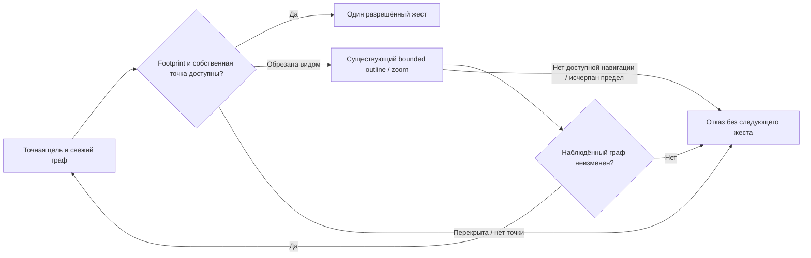

# Взаимодействие с узлами, портами и связями в разросшемся графе

Аналитический срез на 18.10.2026 по LAB-91, LAB-94 и s3/1 R1.8. Реализация
не предлагается к слиянию этой запиской; новых живых прогонов не выполнялось.
r03 остаётся на checkpoint `cf4e9a4ea5188862fd6b2bd83aaa9f7f1557db48`, строго
0/3 model+cold. [PR #125](https://github.com/gooddaytoday/loginom-ai-agent/pull/125)
не влит; его живой положительный эффект пока не установлен.

Общий пробел — различие между доказанным изменением графа и готовностью следующей
цели к взаимодействию. Геометрический допуск не един для drop, подписи, тела,
порта и кривой. Вызов существующего reveal добавлялся только к отдельным веткам,
а его собственная зависимость от outline уже отказывала в LAB-91 при восьми узлах.
Это не доказательство одной физической причины всех ошибок: отсутствие наблюдённой
точки может означать offscreen, clipping, перекрытие или отсутствие пригодного SVG.

## Доказательства и обозначения

Источники — опубликованные журналы, текущие сохранённые журналы последней серии
и исходники проверенных SHA. Старые сеансы не открывались и пакеты не исправлялись.
Полные журналы и персональные профили в Git не добавляются. Выдержка измерений
`large-graph-observations.json` приложена к итоговому комментарию LAB-94.

| Источник | Содержимое |
|---|---|
| [S1](https://mas.kartamyshev.dev/api/attachments/01a14e7a-04f0-7bd3-a590-5f8b9556b7e5/download) | LAB-91, Манки `025b73afac`, `lab91-acceptance-logs.tar.xz` |
| [S2](https://mas.kartamyshev.dev/api/attachments/01a14e96-1508-756d-87e2-8fbfa79335c8/download) | LAB-91, reviewer `025b73afac`, `lab91-reviewer-logs.tar.xz` |
| [S3](https://mas.kartamyshev.dev/api/attachments/01a14f10-0f3d-7761-85e5-40d0501b643f/download) | LAB-91, Манки `9f2611040b`, `lab91-wcalc-logs.tar.xz` |
| [S4](https://mas.kartamyshev.dev/api/attachments/01a14f2d-2315-73f2-adb7-ccf5e544c6df/download) | LAB-91, reviewer `9f2611040b`, `lab91-reviewer-9f-logs.tar.xz` |
| [S5](https://mas.kartamyshev.dev/api/attachments/01a14f5d-9963-7ab9-ac95-c77fa656cd9f/download) | LAB-94, начальные попытки `1339-initial`, `1403-candidate-r1` |
| [S6](https://mas.kartamyshev.dev/api/attachments/01a14f8d-903e-7968-8e3d-42d08a80628b/download) | LAB-94, серия `e7abfb45ef`, `1419/1432/1444-wlinks` |
| [S7](https://mas.kartamyshev.dev/api/attachments/01a15022-3e83-7a1c-8791-05169d1db81f/download) | LAB-94, серия `cf4e9a4ea5`, `1703/1716/1731-reveal`; дополнительные геометрические выдержки — `large-graph-observations.json` |
| [S8](https://mas.kartamyshev.dev/api/attachments/01a14f3a-7820-7a23-9af8-254ea78490ca/download), [разбор](https://mas.kartamyshev.dev/api/attachments/01a14f5e-58f2-79ff-b2c7-713d8ed7161d/download) | LAB-82 R1.8 s3/1 на `f32d694c`; `r18-logs.tar.xz`, `r18-validation.tar.xz` |

`M(x,y)` — логические координаты узла/drop, `S(x,y,w,h)` — CSS-прямоугольник
на экране. Координата запрошенного drop не является координатой порта или точки
кривой. Запрошенные позиции помечены `request`; фактически наблюдённые позиции
узлов указаны без этой пометки. Сетка округляет координаты до 8.

`N / D+F` — число записей `readGraph.nodes`, табличных `links` и `foreign_links`
в снимке **перед указанным примитивом**. N включает служебные узлы, в том числе
переменные сценария, REST-подключения и URL encoders. REST connection edges уже
входят в F: прибавлять `rest_connection_links` ещё раз нельзя. `N_UI` — отдельная
инвентаризация отрисованных именованных узлов, не полный native graph.

`V0` — сохранённый `placement_navigation.view`: viewport 1280×800, canvas
`S(324,100,950,694)`, native scale=1, translate=(0,0), scroll=(0,0).
`V41` — те же размеры/scale/translate, scroll=(41,0). Если указан предшествующий
снимок, это не измерение непосредственно отказавшей точки. Browser
`visual_viewport.scale` не подменяет native graph scale.

`НД` означает, что значение не сохранено в доступном доказательстве. Его нельзя
восстановить из текста ошибки. Для старых LAB-94 модельные результаты сохранены,
но подробных модельных graph-журналов в архиве нет; поэтому количество связей,
точки hit-test и native transform там местами НД. Повторных прогонов для заполнения
пробелов это задание не разрешает.

Коды в таблицах: `O` = `Canvas outline control unavailable`; `P` =
`Port has no observed interaction point` / `OUTPUT_PORT_OPEN_UNCONFIRMED`;
`L` = `Owned link has no reachable curve point`; `C` = `Target is covered`;
`V` = `UI_REFERENCE_OFFSCREEN` / `Observed control is outside the viewport`.
Для модельных операций внешняя ошибка обычно `NODE_APPLY_STOPPED`; это не более
точный диагноз геометрии. Число ×3/×6 — отдельные подтверждённые отказы до жеста,
не число кликов. Их агрегирование не скрывает дополнительный исход прогона.

## Каталог отказов

### LAB-91: outline отказывал до новых исправлений видимости

Показаны и преодолённые моделью отказы: итоговый PASS всего сценария не доказывает,
что исходная ветка навигации заработала. Здесь перечислены все найденные в S1–S4
группы геометрических отказов; повторные checkpoints одного receipt не считаются
новыми случаями.

| Прогон / источник | Операция и жест | N / D+F | Цель | Scale / scroll | Отказ |
|---|---|---:|---|---|---|
| `094401-r2`, S1 | `export-result`, drop экспорта / outline | 8 / 6+1 | M(80,800) | НД | O ×3; впоследствии общий PASS |
| `095308-r3`, S1 | `export-result`, drop экспорта / outline | 8 / 6+1 | M(80,800) | НД | O ×3; впоследствии общий PASS |
| `100909-r1`, S2 | `export-result`, drop экспорта / outline | 8 / 6+1 | M(80,800) | НД | O ×3; итоговый отказ этого прогона — уже скачивание |
| `101948-r2`, S2 | `export-csv`, drop / outline | 8 / 6+1 | M(80,800) | НД | O ×3 |
| `101948-r2`, S2 | `export-csv-positioned`, раскрытие **после** drop | 8 / 6+1 до create | request M(900,400), drop S(1228,500) | V0 до drop | O ×1; созданный узел структурно подтверждён |
| `120755-wcalc-r1`, S3 | `three-result-columns`, drop Reform / outline | 8 / 6+1 | M(80,816) | НД | O ×3; впоследствии общий PASS |
| `122222-wcalc-r2`, S3 | `export-result`, раскрытие после drop | 7 / 5+1 до create | M(240,592), drop S(564,692) | V0 до drop | O ×1; итоговый cold — stale observation |
| `123403-wcalc-r3`, S3 | `result-three-columns`, drop Reform / outline | 8 / 6+1 | M(80,816) | НД | O ×3; впоследствии общий PASS |
| `125118-n1`, S4 | `result-columns`, drop Reform / outline | 8 / 6+1 | M(80,816) | НД | O ×3; впоследствии общий PASS |
| `125118-n1`, S4 | `result-columns-v2`, drop Reform / outline | 8 / 6+1 | request M(1100,500) | НД | O ×3 |
| `130924-n2`, S4 | `export-result`, drop экспорта / outline | 8 / 6+1 | request M(80,800) | НД | O ×3; итоговый cold — только метка |

### LAB-94 до #125

| Прогон / источник | Операция и жест | N / D+F | Цель | Scale / scroll | Отказ |
|---|---|---:|---|---|---|
| `1339-initial`, S5 | `annotate-200`, drop Калькулятора / outline | НД | auto; фактическая позиция НД | НД | O |
| `1403-candidate-r1`, S5 | `status200`, drop Калькулятора / outline | НД | auto; фактическая позиция НД | НД | O |
| `1419-wlinks-r1`, S6 | `key-200`, drop Калькулятора / outline | НД | auto; фактическая позиция НД | НД | O |
| `1419-wlinks-r1`, S6 | `join-404` → `configure-join-404`, открытие input-порта Join | НД | request узла M(600,650); точка порта НД; тот же GUID Join | НД | P, затем та же незавершённая операция/отказ; итоговый FAIL |
| `1432-wlinks-r2`, S6 | `result-200`, drop Калькулятора / outline | НД | auto; фактическая позиция НД | НД | O |
| `1432-wlinks-r2`, S6 | `union-results`, выбор существующей связи для удаления | НД | request нового Union M(800,340); endpoints и точки **удаляемой** кривой НД | НД | L; итоговый FAIL |
| `1444-wlinks-r3`, S6 | `annotate-ok`, drop / outline | НД | auto; фактическая позиция НД | НД | O |
| `1444-wlinks-r3`, S6 | `annotate-ok-v2`, drop / outline | НД | auto; фактическая позиция НД | НД | O |
| `1444-wlinks-r3`, S6 | `final-table`, drop Reform / outline | НД | request M(1060,340) | НД | O; модель затем сохранила другой успешно собранный вариант |
| `1444-wlinks-r3`, S6 | cold `:n12`, выбор тела «Итоговая таблица» | native НД; N_UI=14 | S(1748,412,56,60) | native scale НД; viewport 1280×800, scroll в этой записи НД | V, до клика; model PASS / cold FAIL |

### LAB-94 с #120 и #125: `cf4e9a4ea5`

Здесь доступны подробные `node_target_effect_prepared` / `node_target_checkpoint`
последней серии. Размеры в строках create относятся к графу **до** создания узла;
строка rename/remove_link уже включает созданный узел и его автоматические связи.

| Прогон / источник | Операция и жест | N / D+F | Цель | Scale / scroll | Отказ |
|---|---|---:|---|---|---|
| `1703-reveal-r1`, S7 | `get-404`, раскрытие REST после drop | 8 / 4+1 | M(720,592), drop S(1044,692) | V0 до drop | O ×1; создание структурно подтверждено |
| `1703-reveal-r1`, S7 | `calc-200`, drop / outline | 9 / 5+2 | M(80,848) | НД непосредственно при отказе | O ×3 |
| `1703-reveal-r1`, S7 | `join-original`, раскрытие после drop | 12 / 9+2 | request M(930,260), drop S(1252,364) | V0 до drop | O ×1; создание структурно подтверждено |
| `1703-reveal-r1`, S7 | `join-original`, double-click **подписи** созданного Join для rename | 13 / 10+2 | узел M(928,264); центр подписи НД | V0 был до create; transform на rename НД | C ×6; итоговый FAIL |
| `1716-reveal-r2`, S7 | `get-404`, раскрытие REST после drop | 8 / 4+1 | M(720,592), drop S(1044,692) | V0 до drop | O ×1; создание структурно подтверждено |
| `1716-reveal-r2`, S7 | `decorate-200`, drop / outline | 9 / 5+2 | M(80,848) | НД непосредственно при отказе | O ×3 |
| `1716-reveal-r2`, S7 | `join-original-ids`, drop / outline | 12 / 9+2 | request M(980,280) | НД | O ×3; модель далее собрала/сохранила пакет |
| `1716-reveal-r2`, S7 | cold `:n11/:n12` → reveal `:n13`, тело Join «Итог по RequestId» | 14 / 12+2 **до Save**; cold N_UI=13 | до Save M(704,552); cold S(1564,404,56,76) | native scale НД; scroll.x=0, max_left=585 | O в reveal; model PASS / cold FAIL; close/logout true |
| `1731-reveal-r3`, S7 | `get-404`, раскрытие REST после drop | 8 / 4+1 | M(720,592), drop S(1044,692) | V0 до drop | O ×1; создание структурно подтверждено |
| `1731-reveal-r3`, S7 | `index-ok`, drop / outline | 9 / 5+2 | M(80,848) | НД непосредственно при отказе | O ×3 |
| `1731-reveal-r3`, S7 | `union-results`, раскрытие Union после drop | 13 / 11+2 | request M(900,350), drop S(1228,452) | V0 до drop | O ×1; создание структурно подтверждено |
| `1731-reveal-r3`, S7 | `final-table`, drop / outline | 14 / 13+2 | request M(1050,350) | НД | O ×3 |
| `1731-reveal-r3`, S7 | `final-table-v2`, remove_link `:graph:2…7` | 15 / 14+2 | REST/404 M(720,592), output0 → HasError M(800,552), input0; точка кривой НД | ближайшая успешная navigation в этой операции V41; HasError footprint S(1067,631,88,101), fully_visible=true | L ×6 до клика; итоговый FAIL |

### Демо s3/1 R1.8

| Прогон / источник | Жест | N / D+F | Цель | Scale / scroll | Отказ |
|---|---|---:|---|---|---|
| `s3-reconcile-1-LAB-82-reviewer-1792328720071013722`, S8 | cold `cold-read-expected-0:n12`, click тела сортировки «Долги в порядке заказов» перед чтением выхода | 9 / 7+0 **до Save**; cold N_UI=8 | до Save M(560,464); cold S(1380,228,56,60) | native scale НД; viewport 1280×800, scroll.x=0, max_left=401 | V, effect_possible=false; экспорт и Save подтверждены |

В свежей проверке #120 (`464b2212`, LAB-85 reviewer) s3 дал model+cold PASS,
но `node.viewport.reveal.internal` в живом журнале не было: offscreen-ситуация
не воспроизвелась. Этот PASS не является положительным испытанием самого reveal.

Отказы `complete prepared graph required` (#116/#123), занятого входа после
повторной REST-операции и `The document changed since this observation` относятся
к структуре/владению/epoch. `WIZARD_OPEN_NOT_CONFIRMED` в LAB-91 `103006-r3`
не имеет записанного исходного проверочного снимка; повторное чтение уже видит
правильный REST-мастер ([разбор](https://mas.kartamyshev.dev/api/attachments/01a14e9f-790e-7b40-b81a-4feb2ce84630/download)).
Эти случаи, download и несовпадение метки не выдаются за доказанные геометрические
отказы и не должны исправляться ослаблением canvas guards.

## Где прерывается существующий механизм

Ниже описаны именно функции проверенного `cf4e9a4ea5`, содержащего невлитый #125.
В `nodes-wave2` до #125 ветки навигации порта/кривой отсутствуют.

| Механизм | Что проверяет/делает | Непокрытый случай |
|---|---|---|
| `choosePosition` / `nodePlacementOverflow` | Ищет свободное место в текущем виде; затем выбирает новую строку ниже отрисованных объектов | `occupied` собирает все графовые SVG с `data-tid`, включая bounding boxes связей/подписей. Восемь native узлов уже могут исчерпать такой поиск. Overflow M(80,800/816/848) требует навигации, которая затем недоступна |
| `revealNodePlacement` до drop | Для `nodeId===undefined` требует видимости точки с отступом 8 CSS px | Это нулевой footprint, не будущий узел с портами/подписью. Видимый drop не обещает видимость созданного объекта |
| `revealNodePlacement` после create / `revealPreparedGraphNode` | Собирает прямоугольник тела и дочерних drawings; через существующий outline уменьшает graph scale, максимум 12 шагов; `samePlacementGraph` проверяет граф | Внутри прямоугольника нет проверки перекрытия. Зависимость от точного `btnShowOutline` / owned zoom остаётся обязательной. O означает, что zoom не был видим, а toggle не оказался единственным видимым; журнал не различает count и visibility. Утверждать причину отсутствия кнопки нельзя |
| `prepareNodeTarget` / `verifyNodeTargetEffect` | Может подтвердить уже созданный узел и допустимые auto-created links по native graph даже после AMBIGUOUS receipt при подтверждённой cleanup | Структурное доказательство создания не доказывает успешное раскрытие. В r1 после O выполнялся rename, который собственного reveal не имеет |
| `revealGraphNode` в `launchGraph` (#120) | Перед select/execute вызывается, если body имеет `interaction.state=outside_viewport`; затем требуется свежая наблюдённая точка | Частично обрезанное тело или `point_not_observed` не входят в этот trigger. Цель другого вида — подпись/порт/кривая — не покрывается самим вызовом тела |
| Порт (#125) / `openPreparedOutputPort` | #125 вызывает node reveal при наблюдённом порте нужного направления с `outside_viewport`; открытие заново проверяет native port и 9 точек | Перекрытый или обрезанный краем canvas порт может лежать внутри browser viewport и не иметь `outside_viewport`. P не различает эти причины. В S6 нет координат hit-test, поэтому offscreen того случая не доказан |
| `remove_link` (#125) | Проверяет 3 доли длины SVG path; при отсутствии hit и наличии sample вне **browser viewport** раскрывает endpoints и ищет точку заново | Browser viewport шире видимого canvas. Clipping canvas/накладка/другой SVG при всех samples внутри browser viewport не вызывают reveal. Нет path/CTM — ещё одна возможность. В r3 отказ был до ветки навигации связи; фактические samples/hits не сохранены |
| `point()` для rename/move/add_input | Проверяет единственный центр элемента через `elementFromPoint` | Сообщение C объединяет выход за browser viewport и чужой hit. Автонавигации здесь нет; оно само по себе не доказывает перекрытие узлов |

`samePlacementGraph` игнорирует только `nodes[].dom_epoch` для допустимого SVG
перерисовывания и сохраняет сравнение наблюдённых узлов/позиций/портов/связей.
Это не независимое чтение всех внутренних настроек узлов. Навигация не получает
права менять их или вызывать внутренние методы Loginom.

### Раскладка модели и Save

1. **До Save:** O встречается на автоматическом overflow и на явных позициях у
   правого/нижнего края. В r1 Join создан около правой границы; центр его подписи
   не записан, поэтому выход подписи за край — обоснованная гипотеза, а конкретный
   перекрывающий объект не установлен. Терминальный отказ был на rename, не на порте.
2. **Близость узлов:** в r3 native drop финального Калькулятора создал связь
   REST/404 output0 → HasError input0, которую target-фаза затем должна была удалить
   перед подключением требуемого источника. Это наблюдённый auto-created link,
   не доказанная «чужая» связь. Новое тело с портами было полностью видно, но точка
   старой кривой не нашлась. Полная видимость одного endpoint не решает задачу кривой.
3. **После Save:** s3/1 R1.8 и LAB-94 `1716` сохранились, затем cold увидел целевой
   узел далеко справа. В обоих Save записал `arrangement=attempted/result_unconfirmed`.
   Нельзя объявить точное перемещение доказанным результатом #113: до Save записаны
   M-координаты, после открытия — S-прямоугольники, полного native transform после
   открытия нет. Но контракт продолжения обязан работать с фактическим сохранённым
   расположением независимо от того, кто его выбрал. Отрицательный y не наблюдался.
4. **Размер:** отказы есть уже при N=8; последняя серия дошла до N=15, а не до
   лимитов 200 узлов / 400 табличных связей. Длинные цепочки и две REST-ветви увеличивают
   давление на placement, но сбой не объясняется одним порогом количества узлов.

Ни один из трёх модельных журналов `cf4e9a4ea5` не содержит
`reveal_prepared_node`. Cold `1716` содержит подготовку этого шага `:n13`, затем
O. У отказавших remove_link r3 нет `placement_navigation`. Следовательно,
положительная живая работа добавленных в #125 веток **не показана**; отсутствие P
в новой серии не заменяет такой проверки. Удержание #125 до решения обосновано.

## Одно системное предложение: единый допуск геометрии canvas

Принять одну политику в существующих canvas-процедурах: **перед каждым жестом
точная цель в текущем owned canvas должна иметь достаточный видимый footprint
и свежую наблюдённую точку, принадлежащую этой цели.** Для drag одновременно
проверяются source и target; для удаления связи — точка на её собственной кривой,
а не только видимость узлов. Для нового drop видимость точки разрешает только
сам drop; после появления узла его полная геометрия должна быть заново допущена
перед rename/портом/следующим жестом.

Если цель обрезана viewport/canvas, использовать **тот же** bounded native
outline/zoom и существующий reveal, затем перечитать transform, граф и точки.
Сначала установить доступность принадлежащих текущему workflow средств навигации.
Если их нет, либо target по-прежнему перекрыт/не наблюдён, отказать до этого жеста
с различённой причиной. Zoom не обещает устранить перекрытие двух объектов;
не двигать узлы, не менять layout, не скрывать blockers и не применять force-click.

Это предложение о согласованном использовании текущих процедур, не новый
диспетчер, публичный API, receipt/witness или способ обхода transport. Сохранить
исходные document/tab/workflow/node/port/SVG bindings, общий deadline и существующий
журнал. После navigation старые UI refs/координаты не использовать. Если предыдущий
шаг уже изменил граф, честно сохранить частичный исход операции; `NOT_APPLIED`
одного нового жеста не превращает всю операцию в «без эффектов». Не повторять
неизвестный click/drag. Различать в существующем outcome offscreen/clipped,
covered, отсутствующий SVG и недоступную навигацию; записывать там же измеренные
rect/point/scale/scroll и hit identity без текста/секретов, а не создавать новый
механизм доказательств.

### Объём, риск и проверка после отдельного решения

Оценка до исследования реальной доступности outline: 5–7 существующих runtime
файлов (`node-placement`, `node-target-browser`, `node-procedure`, `node-port-open`,
`node-execution-procedure`, canvas/link участки `executor` при необходимости),
примерно 200–350 строк продукта и 200–350 строк адресных тестов. Это ориентир,
не разрешение расширять объём; сначала нужно установить точный native control
в отказавших видах. Оценочно 1–2 рабочих дня реализации/проверки плюс отдельное
окно живой регрессии и независимой приёмки; в один короткий W по тексту ошибки
работа не помещается. `cold-check`, oracle, бизнес-задания и auto-layout Save
изменения для этой политики не требуют.

| Риск для демо | Ограничение предложения |
|---|---|
| Высокая область влияния: общий canvas у всех стандартных узлов, s3 и продолжения s1→s8 | Отдельный общий PR и решение владельца до реализации; #125 не считать принятой основой без проверки |
| Zoom меняет портовые координаты, SVG epochs и cloned outline SVG; drag может попасть в другой порт | Перечитывать обе стороны до mouse-down; сохранять native identity, scoped graph root и существующие guards во время удерживаемого жеста |
| Дополнительные чтения съедают deadline; миниатюрные порты после zoom могут быть непригодны | Сохранить нынешний предел navigation/общий deadline; явный отказ вместо новых таймаутов или бесконечного zoom |
| Политика может раньше отказать там, где модель ранее обходила ошибку явной позицией | Проверить нормальный видимый путь без навигации и не выдавать намеренный safe refusal за бизнес-PASS |
| Save снова меняет расположение перед cold/продолжением | Допуск по свежему фактическому виду после открытия; не требовать старых M-координат и не менять само упорядочивание |

Будущий адресный набор должен покрыть тело/подпись, порт, кривую и drop: полностью
вне вида, частичный canvas clipping при нахождении внутри browser viewport,
перекрытие другим узлом/контролом, отсутствие path/CTM, отсутствующий/чужой outline,
изменение графа во время navigation, неизвестный ответ уже выполненного жеста.
Отдельный случай — «create подтверждён, full reveal отказал»: следующий rename
не должен выполняться по старому допуску точки drop.

Для живой приёмки после разрешения нужны положительные записи реального перехода
«невидимая цель → существующий reveal → единственный подтверждённый жест» для
порта и кривой, свежий saved s3/cold с offscreen body и продолжение после Save,
затем REST r03 и регрессия демо s3/s4/s8 на одном SHA. Одного случайного PASS без
navigation, как в проверке #120, недостаточно. Перекрытая цель без безопасного
способа раскрытия должна остаться отказом. В этой записке таких новых прогонов нет.

## Проверенные точки исходников

- [node-placement.mjs на cf4e9a4ea5](https://github.com/gooddaytoday/loginom-ai-agent/blob/cf4e9a4ea5188862fd6b2bd83aaa9f7f1557db48/packages/loginom-runtime/client/lib/node-placement.mjs): `nodePlacementViewport`, `revealNodePlacement`, `revealPreparedGraphNode`, `samePlacementGraph`.
- [node-target-browser.mjs](https://github.com/gooddaytoday/loginom-ai-agent/blob/cf4e9a4ea5188862fd6b2bd83aaa9f7f1557db48/packages/loginom-runtime/client/lib/node-target-browser.mjs): `choosePosition`, `point`, create/rename/remove_link.
- [node-target.mjs](https://github.com/gooddaytoday/loginom-ai-agent/blob/cf4e9a4ea5188862fd6b2bd83aaa9f7f1557db48/packages/loginom-runtime/client/lib/node-target.mjs): structural create proof и подтверждённые отказы до эффекта.
- [node-procedure.mjs](https://github.com/gooddaytoday/loginom-ai-agent/blob/cf4e9a4ea5188862fd6b2bd83aaa9f7f1557db48/packages/loginom-runtime/client/lib/node-procedure.mjs), [node-port-open.mjs](https://github.com/gooddaytoday/loginom-ai-agent/blob/cf4e9a4ea5188862fd6b2bd83aaa9f7f1557db48/packages/loginom-runtime/client/lib/node-port-open.mjs), [node-execution-procedure.mjs](https://github.com/gooddaytoday/loginom-ai-agent/blob/cf4e9a4ea5188862fd6b2bd83aaa9f7f1557db48/packages/loginom-runtime/client/lib/node-execution-procedure.mjs): triggers reveal и повторное наблюдение перед жестом.
- [executor.mjs](https://github.com/gooddaytoday/loginom-ai-agent/blob/cf4e9a4ea5188862fd6b2bd83aaa9f7f1557db48/packages/loginom-runtime/client/lib/executor.mjs): `package_arrangement` — attempted/result_unconfirmed перед Save, не доказательство окончательной геометрии.
