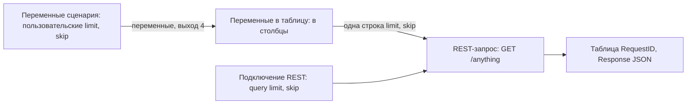

# Переменные и REST: исследование и предложение W1

LAB-820, 04.11.2026. База `origin/v040` =
`aa49dc7d88b79917b1ba93d721880b155c4f19c9`. Код runtime не меняется.
Ниже разделены наблюдения Loginom 7.4.2 и **предложение**, требующее утверждения
перед этапом 1. Решение по источнику: комментарий назначения от 04.11 — только
уже принятый `https://httpbin.org/anything`, два последовательных запроса.

## Результат и границы проверки

Переменные пользователя — отдельный редактируемый набор **текущего сценария**,
выход 4 встроенного узла «Переменные сценария». Это самостоятельный источник;
для создания `limit`/`skip` Калькулятор не требуется. Значения меняются в мастере
этого порта, настройки потребителей остаются прежними.

Рабочий наблюдённый путь query-параметров:



Прямая связь пользовательских переменных с управляющим входом REST **не**
создаёт query bindings: без входной таблицы наблюдался `args={}`.
Штатный мост «Переменные в таблицу» передаёт значения в поля запроса; оба
набора параметров и повторное выполнение после cold-open проверены живьём.
Предлагается явно строить этот мост в сценарии. Не обещать модели несуществующий
переключатель «query из переменной» и не скрывать создание дополнительных узлов.

Это native discovery, не модельная приёмка обработчика: экспорт разобранного
ответа, 2/3 модельных PASS и автоматический typed cold-reader ещё предстоят
этапу 1. Сборки CLI не выполнялись.

## Доказательства

Все жесты — по наблюдённым `data-tid` на
`https://app.loginom.ai/app/?testable=true`, в worker указанной в карточке пары.
Нативные объекты читались только у открытого собственного графа/мастера/preview;
скрытые серверные вызовы, подмена JS и прямые HTTP-запросы к httpbin не применялись.
Сохранены два новых пакета только в каталоге worker: `lab820-variables-20261104.lgp`
и `lab820-ports-20261104.lgp`. Второй — инвентаризация, не бизнес-кандидат.

Сырые журналы не входят в Git. Выдержки с исходным именем журнала, номером строки
и временем, а также скриншоты прилагаются к итоговому комментарию LAB-820.
Обозначения ниже: `main` = `ui.jsonl`, `cold` = `cold/ui.jsonl`,
`ports` = `ports/ui.jsonl`. Номер после двоеточия — строка исходного журнала.

| Доказательство | Источник |
|---|---|
| Редактор пользовательских переменных; Name, DisplayName, DataType=4, 3/2 | `main:23–31` |
| Native версия 7.4.2; порты сценария и REST | `main:42` |
| Вход переменных REST: mapping и связь с source record | `main:76–77` |
| Без табличного входа `args={}`, URL без query | `main:84` |
| После моста: поля integer, параметры string, autolink пуст; ручные связи созданы | `main:117`, `main:120` |
| Ответы 3/2 и 5/10; между ними редактировался только источник переменных | `main:122`, `main:125–127` |
| Полный preview набора переменных: имена, метки, типы, значения | `main:128` |
| Save, точный путь пакета, package inventory=0 и logout | `main:131–132`, `main:141`, `main:143` |
| Новый профиль, повторное открытие, сохранённые GUID/связи, новое выполнение и переменные 5/10 | `cold:1–4` |
| Cold cleanup: package_closed=true, logged_out=true, modified_before_close=false | `cold:6` |
| Палитра, инвентаризация пяти переменных компонентов | `ports:1–3` |
| Отдельный скрытый control-порт, его показ, связь и mapping-мастер | `ports:3–6`, `ports:8` |
| Вход переменных подмодели, внутренний граф и входной узел | `ports:12–15` |
| Отдельная страница переменных пакета; Калькулятор переменных | `ports:18–21` |
| Save исследовательского пакета и cleanup true/true | `ports:22`, `ports:24` |

## Порты и связи

На графе переменные имеют округлые порты; табличные порты — прямоугольные.
Имена DOM отражают вид, но **не являются identity**. Native `FType`: 0 вход,
1 выход; `FSubType`: 1 таблица, 3 переменные, 4 отдельные управляющие переменные.
Subtype 10 у «Соединение (переменные)» — кнопка добавления входа, не источник данных.

| Узел / native icon | Наблюдённые порты |
|---|---|
| Переменные сценария / `modelvariables` | `Output_Var-0..4`, subtype 3 |
| Калькулятор (переменные) / `calcvariables` | `Input_Var-0`, `Output_Var-0`; отдельно скрытый subtype 4 `Input_ControlVar` |
| Замена (переменные) / `replacevariables` | `Input_Var-0`, `Output_Var-0`; скрытый subtype 4 |
| Соединение (переменные) / `unionvariables` | `Input_Var-0`, `Input_Var-1`, `Input_Add`, `Output_Var-0` |
| Переменные в таблицу / `variablestodata` | `Input_Var-0` → `Output_Data-0` |
| Таблица в переменные / `datatovariables` | `Input_Data-0` → `Output_Var-0` |
| REST-запрос / `restclient` | connection 0, **`Input_Var-1` subtype 3**, `Input_Data-2`; два табличных выхода |
| Подмодель / `modelgeneric` | Настройка `GenericModelComponentWizard`: добавить вход/выход типа «Переменные», «Таблица» или «Дерево данных»; после добавления входа виден `Input_Var-0` |

Таблица перечисляет исследованные узлы, а не обещает инвентаризацию всех
компонентов платформы. У остальных узлов возможность управляющего входа надо
подтверждать их собственным наблюдаемым портом/командой меню.

Связь создаётся штатным drag-and-drop из `Output_Var-N` в `Input_Var-N` либо
`Input_ControlVar`. У Калькулятора оба назначения существуют одновременно.
Показ скрытого управляющего входа: `mn;mniShowControlVariablesPort`.
У REST справка называет вход управляющим, хотя его **native subtype=3**;
нельзя выводить subtype из русского заголовка.

Пример наблюдаемой связи:
`...;Graph;Переменные_сценария|Output_Var-4|REST-запрос|Input_Var-1`.
Для REST порядковый номер табличного входа в API остаётся **0**, несмотря на
нативный суффикс `Input_Data-2`. Переменные не должны сдвигать старые индексы таблиц.
При добавлении узла Loginom может автоматически присоединить подходящий источник:
наблюдать фактические связи после каждого добавления, не считать их отсутствующими.

Контекстное меню порта → `mn;mniConfigurePort` открывает
`MF;TF-1;WizrdMCF;TuneVariablesMappingWizard` с заголовком
«Настройка соответствия между переменными». Есть режимы «Таблица»/«Связи»,
входное и выходное имя/метка, назначение, значение, описание, autosync.
В REST наблюдались `OriginType=0`, `ConnectedRecord.data.Name=limit/skip`:
это входная связь, в отличие от локальных значений `OriginType=1`.
Управляющий input subtype 4 использует тот же мастер.

`FGuid` порта повторяется у разных узлов; GUID встроенного узла повторился
в разных пакетах. Надёжная identity включает document, workflow, node и port,
плюс проверку native owner и графа. Caption и один port GUID недостаточны.

## Что пользователь редактирует

У «Переменных сценария» выходы: 0 общий набор, 1 система, 2 сессия, 3 пакет,
4 пользовательские. В preview видны соответствующие вкладки (`main:85`);
tooltip выхода 4 — «Переменные пользователя» (`main:16`).
Выход 0 не следует выбирать для этого примера: нужны ровно две собственные
переменные, без зависимости от переменных сервера/сессии.

Выход 4 → «Настроить порт» открывает `VariablesEditValuesWizard`,
«Настройка значений переменных». Добавление/редактирование — `EditVariableForm`:
`edtName`, `edtDisplayName`, `cbxDataType`, `cbxNullValue`, редактор значения,
`edtDescription`, `btnApply`. Для integer значение вводится в
`pgcValue;Int64Field`; в списке типов наблюдались Boolean, datetime, real,
integer, string, Variant. Проверено выполнение только двух малых integer.
После смены значений источник деактивируется с штатным подтверждением;
повторное выполнение REST пересчитывает цепочку. При правке полей нужен readback
после blur: в исследовании native автометка дополнила метки до
`limitКоличество` и `skipСмещение`, что видно и после cold. Имена остались точными.

Переменные **пакета** — отдельная страница Package → «Переменные»,
`PackageVariablesForm;grdPackageVariables`: имя, метка, значение, описание,
«Скрытая», «Только для чтения», команды добавить/редактировать. Это не набор
пользовательских переменных сценария. Создание значения пакета не проверялось.

У подмодели внешний вход переменных создаётся в `GenericModelComponentWizard`;
после «Войти» (`GenericEnterLabel;Label`) внутри появились «Входной узел» с
`Output_Var-0` и собственные «Переменные сценария» с пятью выходами. Это разные
источники. Межсценарные refs напрямую переносить нельзя. Изменение собственного
пользовательского набора подмодели и его cold здесь не принимались.

Калькулятор (переменные) — вычислитель, мастер `CalcVariablesWizard`,
«Редактирование выражений». Он получает/выдаёт набор переменных; это не обязательный
редактор пользовательских значений. Семантика формул относится к его подплану.

Справка подтверждает различие областей и назначений:
[Переменные сценария](https://help.loginom.ru/userguide/workflow/variables/scenario-variables.html),
[Управляющие переменные](https://help.loginom.ru/userguide/workflow/variables/control-variables.html).
Приоритеты разрешения совпадающих имён и права пользователей в этом исследовании
не испытывались; документированное поведение не является live PASS.

## REST: настройки и выполненный пример

Подключение создано обычным мастером `WizardModelConnectionForm;ConnectionWizard`:
GET, URL `https://httpbin.org/anything`, режим query, параметры `limit`, затем
`skip`, оба string, без authentication, проверка сертификатов включена.
Узел REST использует отдельную ссылку подключения на графе.

На странице `RESTRequestWizard;ParamLinks` слева **поля таблицы**, справа
URL-параметры. Переключателя query→variable не наблюдалось. Управляющий вход
сам по себе не добавил параметры, что подтверждено ответом `main:84`.
После подключения и выполнения «Переменные в таблицу» слева появились поля
`limit`/`skip` integer. Native autolink не сопоставил integer со string;
ручные связи полей с параметрами сработали и сохранились. Для field-ячейки
`colColumnName_N` N — индекс поля, для `colParam_name` — имя параметра.

| Выполнение | Исходные переменные | Возвратившийся `args` | Возвратившийся `url` |
|---|---|---|---|
| Первое | integer 3, 2 | `{"limit":"3","skip":"2"}` | `https://httpbin.org/anything?limit=3&skip=2` |
| После правки только переменных | integer 5, 10 | `{"limit":"5","skip":"10"}` | `https://httpbin.org/anything?limit=5&skip=10` |
| Cold, новое выполнение | сохранённые integer 5, 10 | `{"limit":"5","skip":"10"}` | `https://httpbin.org/anything?limit=5&skip=10` |

Ответ — одна строка `RequestID=0`, `Response:string`. Полный JSON нельзя
сравнивать целиком: там есть нестабильный origin. Проверяются только `args`
и `url`, извлечённые из **ответа**, не восстановленные из входных переменных.
Разбор JSON → финальная таблица использует существующий путь принятого REST-сценария.

Runtime базы поддерживает **только string поля** query:
`rest-request-parameters.mjs`, `rest-request.mjs:108–122`.
Поэтому предлагаемый продуктовый сценарий сначала переводит две integer-колонки
в string существующим «Параметры полей», затем использует прежний REST handler
с его штатным URL encoder. Это композиция открытых узлов, не расширение
множества типов старого REST-контракта. Нативно конверсия integer→query проверена;
полная модельная композиция с конверсией/encoder/экспортом — ещё нет.

## Чтение и сохранение

Выход переменных открывается «Быстрым просмотром»/двойным щелчком порта после
выполнения. Собственный root:
`ModelForm;PreviewWindow;PreviewForm;VariablesForm;grdValuePreview`.
Native bound Ext store содержит `ID`, `Index`, `Name`, `DisplayName`, `Description`,
`DataType`, `ValueVariant`. Живьём прочитаны все две записи: 5 и 10, type 4.
На DOM есть `colName_limit`, `colDisplayName_limit`, `colValue_limit` и аналоги skip.
Это штатная UI-поверхность для будущего reader; серверные getters не нужны.

Сейчас **публичного runtime-reader переменных нет**. `readGraph` базы в новом
профиле вернул переменные в `other_ports`/`foreign_links`, не в typed outputs
(`cold:2`). Он распознал прежний табличный вход REST как 0. `dock_node_read`
пока требует завершённый табличный результат; локальный CrossTable reader
читает лишь свои control defaults и не заменяет чтение выходного набора.

Save и cold-open сохранили имена/метки/типы/значения, связи переменных и таблицы,
соединение REST и query mappings. Document/workflow IDs в новом профиле изменились;
node GUID сохранились. После открытия настройки не применялись заново,
REST выполнен штатной командой, прочитаны новый Response и исходный набор переменных.
Это поведенческая проверка сохранения пакета; внутренний XML/формат .lgp не изучался.

## Предложение W1: отдельная адресация переменных

Все имена ниже — **проект**, отсутствующий в базе. Не менять протокол Agent/Host
и `packages/agent`; расширять только существующий локальный node API после
утверждения этого предложения. Не менять смысл `inputs`, `read.ports` и их индексы.

1. `dock_workspace_observe` выдаёт существующий builtin как тип
   `variables.user` с `target_modes:["existing"]` и отдельным списком выходов
   переменных 0..4. Ref берётся из актуального observed graph, не собирается по
   имени или известному GUID. `target:new` для builtin отклоняется до UI.
   Запись разрешена только в наблюдённый пользовательский выход 4; system/session
   и merged-порт не редактируются. На первом этапе — корневой сценарий.
2. В `dock_node_apply` добавить необязательный `variable_inputs`, независимо от
   старого `inputs`. Элемент:
   `{source:NodeRef, output:4, input:0, kind:"variables"}`.
   `kind` имеет два значения: `variables` (native subtype 3) и `control`
   (native subtype 4, только input 0). Обычный выход переменных может питать оба.
   Для REST input variable ordinal=0 соответствует native `Input_Var-1`;
   эта связь управляет настройками, **не query**. Нельзя соединить table→variables,
   variables→table, input→input, владельцев разных workflow или неподдерживаемый порт.
3. Отсутствующий/пустой `variable_inputs` сохраняет связи существующего узла,
   как старое `inputs:[]`. Создание/замена одной связи — только явно указанные
   endpoints; чужие связи не удаляются. Несколько источников одного target
   `(kind,input)` отклоняются. Отдельного массового удаления не добавлять.
4. `mappings` получает необязательный `kind:"variables"|"control"`;
   отсутствие сохраняет старую табличную семантику. Индекс порта нормализуется
   внутри своего вида. Использовать существующие source/schema identities,
   autosync и сохранение неуказанных полей; для переменных нет `data_kind`.
   Writer открывает собственный `TuneVariablesMappingWizard`, читает источники,
   локальные defaults и реальные связи; не превращает connected variable в local.
5. Для `variables.user`, mode `values`: `parameters.variables` — patch по точному
   имени с типом и значением, optional label/description для создания. Пример:
   `[{"name":"limit","type":"integer","value":3},{"name":"skip","type":"integer","value":2}]`.
   Существующий тип/ID не менять, неуказанные переменные сохранять. Первое
   приращение — safe integer, boolean, string и явный NULL; остальные типы
   отклонять до мутации, пока их native codec и редактор не доказаны.
6. `read.variable_ports:[4]` и ответ `output.variable_ports` — отдельно от таблиц.
   Порт содержит ordinal, port GUID, NodeRef, execution ID, полную schema,
   упорядоченные variable IDs/name/label/type и типизированные значения с
   `is_null`/precision. Переиспользовать существующий scalar value envelope;
   небезопасный integer не округлять, неизвестную точность не выдавать за exact.
   Верхняя граница первого приращения — 128 переменных на порт. Полнота
   доказывается count/store/уникальностью IDs; обрезанный набор не PASS.
7. `dock_node_read` по успешному `source_operation_id` перечитывает тот же набор
   после нового выполнения, без открытия редактора. Для существующего cold-узла
   сначала existing apply с пустым patch и read.variable_ports; новые operation IDs,
   сохранённые source refs предыдущего документа не переносить.

Пример только новой части apply для «Переменные в таблицу»:

```json
{
  "inputs": [],
  "variable_inputs": [{
    "source": {"document_id":"issued","workflow_id":"issued","node_id":"issued"},
    "output": 4, "input": 0, "kind": "variables"
  }],
  "read": {"ports":[0],"variable_ports":[]}
}
```

Поля исходного apply (operation/target/mode/finish) остаются обязательными;
это фрагмент, не исполняемый запрос. Для Калькулятора переменных обычный input
и control input могут быть указаны одновременно и проверяются независимо.

### Readback и cold в W1

Readback обязан включать фактические endpoints `(NodeRef,kind,ordinal,port_guid)`
и reciprocal native edge; variable mapping: source ID/name/type, target ID/name/type,
local/connected, autosync. Настройки подтверждать независимым чтением после Done,
а не эхом запроса. Сохранение пакета — отдельная операция, не `package_saved:true`
после apply. Сохраняются прежние journal, gate, receipts, uncertain-effect и cleanup.

Предлагаемое добавление к существующей cold-проверке — optional typed inventory
переменных с теми же owner/type/complete правилами; таблицы продолжают проверяться
старым matcher. Проверять обе исходные переменные напрямую в VariablesForm и
финальный разобранный REST-ответ отдельно. Таблица VarToData не является
доказательством native variable output. Это конкретный объём приёмки W1 для
утверждения, а не уже разрешённый/реализованный новый механизм проверки.

Проверки этапа 1: create/read 3/2; patch только values → 5/10; сохранение ID/type;
сохранение посторонней переменной; повторный read без reconfigure; NULL против
0/false/empty; отказ другой workflow/port kind/дублирующего source; control отдельно
от обычных variables; Save → новое открытие → новое выполнение → exact values,
реальные связи, cleanup true/true. Для REST также сравнить первоначальный и конечный
readback запроса/подключения и два CSV: query bindings между выполнениями неизменны.

### Общие файлы и оценка объёма

Оценка добавленных/изменённых строк, не обещание размера диффа. Новые модули не
предлагаются: расширять существующие владельцы минимально. Узловые обработчики
Калькулятора/VarToData/DataToVar — в их подпланах, не в общем W1.

| Файлы | Что меняется | Строки |
|---|---|---:|
| `client/lib/node-contracts.mjs`, `.d.ts`, `node-api.mjs`, `node-result-schema.mjs`, `user-workflow.mjs`, `user-results.mjs` | additive inputs/read/results, builtin existing-only | 160–240 |
| `node-target-browser.mjs`, `node-target.mjs`, `workspace-ui.mjs` | typed port inventory, variable edges, source refs и owner validation | 180–260 |
| `node-port-open.mjs`, `node-procedure.mjs`, `node-support.mjs` | variable/control wizard lifecycle, routing/registration | 100–160 |
| `crosstable-variables.mjs` | переиспользовать ограниченный редактор и inventory, сохранить его старый локальный путь | 80–140 |
| `node-output-context.mjs`, `node-output-procedure.mjs`, `node-read-contract.mjs`, `node-read-driver.mjs` | VariablesForm read, completeness, reread | 150–230 |
| `scripts/node-acceptance/{cold-check,expected-outputs}.mjs` и адресные tests | утверждённый variable inventory рядом с прежними таблицами | 100–160 |
| `client/test/*variables*.test.mjs`, targeted port/schema tests | защита старых путей и новых отказов | 180–260 |
| Product skill: общая ссылка и файлы `references/nodes/variables.user.md`, REST/переменные | контракт и явная композиция | 70–110 |
| **Всего W1, включая проверки/документацию** | | **1020–1560** |

Точное распределение редактора builtin надо закрепить на первом implementation
цикле; это не разрешение на общий рефакторинг CrossTable. Пути указаны относительно
`packages/loginom-runtime`, кроме явно указанных scripts и product skill.

REST-привязка отдельно: **нового параметра `query_parameters[].variable` не нужно**.
Модель явно создаёт source → VarToData → Field Parameters(integer→string) →
старый REST query/encoder → разбор ответа → экспорт. При готовых W1/VarToData
изменения REST-кода не требуются; ориентир 40–80 строк справки/комплекта и
120–200 строк проверки неизменности настроек в существующем адресном аудите и
40–70 строк регистрации двух фаз в `scripts/node-acceptance/run-check.py`,
если эти расширения будут утверждены. Нативная ручная integer→string связь
**не** повод молча расширять старый REST handler.

### Что разрешено и что требует решения

В текущем этапе разрешены исследование, этот проект контракта, комплект и docs-PR.
После утверждения W1 отдельной карточкой можно реализовать перечисленные
additive поля, типизированные связи, builtin patch и reader без повторного вопроса
по каждой обычной UI-операции. Не меняются поведение старых узлов, смысл табличных
индексов, локальные CrossTable bindings, JS/деревья, семантика выполнения/Save,
deadline и gate. Новый универсальный evaluator/server API не нужен.

Отдельное решение необходимо для изменения публичного Host/Agent протокола,
прямых query→variable bindings вместо явного моста, general nested-workflow
редактирования, глобального scope пакета/сессии, неподтверждённых типов/precision,
автоматического изменения старых REST источников/encoder или иной cold-проверки.
Если обязательна именно **прямая** query-привязка без VarToData, это подтверждённый
пробел native UI и стоп перед реализацией, а не скрытый fallback.

## Бюджеты модели и этап 1

На базе измерено: `SKILL.md` **39 686 Б**, запас до 40 000 — **314 Б**.
Существующий REST node reference — **609 Б**, предел файла узла по назначению
6 000 Б. Тест `model-schema-budget.test.mjs` (41 PASS) измерил compact
`dock_node_apply`: **13 181 Б**, запас **6 819 Б** до 20 000; полная внутренняя
input schema 50 099 Б не является видимой модельной схемой.

Предлагаемый расход: SKILL только ссылка ≤150 Б, общая инструкция в reference;
`variables.user.md` ≤3 000 Б, REST reference после дополнения ≤2 000 Б,
каждый прочий файл узла ≤6 000 Б. Для additive apply резерв ≤2 000 Б
(ожидаемый итог ≤15 181); после реализации измерять сериализованные
name+description+inputSchema **после userNodeTool**, не исходный schema-файл.
Нельзя заранее считать освобождение SKILL выполненным; более длинное изменение
ждёт фактического свободного места. Бюджеты не повышаются.

Цикл = implementation → адресные проверки → живой бизнес-прогон на новом SHA;
это оценка, не изменение лимита 1800 с на модельный прогон.

| Часть этапа 1 | Оценка | Выход цикла |
|---|---:|---|
| W1: inventory/refs, typed variable/control link | 1 цикл | связь без сдвига таблиц; owner/kind отказы |
| W1: builtin user values + exact VariablesForm reader | 1 цикл | модель создаёт 3/2, меняет на 5/10, reread |
| W1: mapping/readback/cold и регрессия | 1 цикл | cold variable inventory и прежние table/control кейсы |
| **W1 всего** | **3 цикла; резерв +1 по наблюдённому отказу** | 2/3 PASS на одном SHA, затем независимая приёмка |
| REST-композиция при готовых W1 и VarToData | **1 цикл; резерв +1** | два эхо-ответа/CSV, unchanged request, final cold |

Не требуется ждать другого SHA: назначение реализации должно взять актуальную
базу и включить нужный объём явно. Отсутствующий handler VarToData — явная
зависимость бизнес-примера, а не основание заменить его JS или выдавать native
discovery за модельный PASS. Бюджет W1 больше прежних 400 строк — он показан
здесь для утверждения объёма оркестратором до кода.

## Приёмочный комплект

`fixtures/rest-variables.json`, manifest, `acceptance/task-rest-variables.md`,
независимый `oracle.py`, `expected-initial.json`, `expected.json` созданы
до первого выполнения REST в этом исследовании. Подробности запуска и границ
проверки — [acceptance/README.md](acceptance/README.md). Новый источник не нужен.
