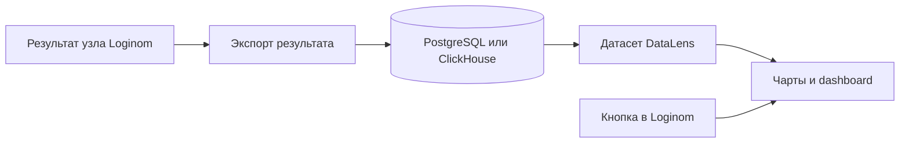

# DataLens для dashboard в Loginom

Проверено 2026-11-03. Продолжение исследования BI-фреймворков; отдельная записка без изменения материалов основного потока.

## Вывод

**Да, DataLens можно рассматривать, и его стоит включить в основной список кандидатов на полноценный BI-конструктор.** Он даёт готовые визуальный редактор, датасеты, вычисляемые поля, dashboard и селекторы. Но использование всей платформы означает интеграцию двух приложений и организацию серверного источника данных, а не только загрузку JS в клиент Loginom.

Для нашей задачи есть три разных варианта:

1. **DataLens OSS как отдельная BI-система**: результаты Loginom доступны через поддерживаемый источник, а кнопка в Loginom открывает соответствующий dashboard. Это реалистичный вариант, но автоматизация объектов и приватное встраивание нуждаются в отдельной проверке именно OSS-сборки.
2. **DataLens Enterprise или Cloud**: там документированы публичный API, SDK/MCP и приватное встраивание. Это более готовый программный путь, но другой дистрибутив/сервис и условия использования.
3. **Компоненты интерфейса DataLens — Gravity UI DashKit и Charts**: использовать их в собственном frontend прямо над данными узла. Тогда отдельная BI-платформа не обязательна, но семантика, преобразование данных и часть редактора остаются нашими.

Наиболее существенная находка: **официальные DataLens skills действительно существуют и представлены на skills.sh**. Однако наличие этих skills не подтверждает готовую совместимость SDK и embedding с открытым Docker Compose-дистрибутивом. Источники и границы поддержки разобраны ниже.

## Что проверено и какая версия имеется в виду

Изучены репозитории `datalens`, `datalens-ui`, `datalens-us`, отдельные части `datalens-backend`, официальные `datalens-sdk`, `datalens-mcp`, `datalens-skills`, `datalens-examples`, исходники OSS-документации и библиотеки Gravity UI.

На дату проверки последняя GitHub Release основного дистрибутива — **v2.9.0 от 19 февраля 2026 года**. В текущем `versions-config.json`/Compose указаны UI `0.3831.0`, backend `0.2457.0`, US `1.39.0`, Auth `0.27.0`, MetaManager `0.52.0`. Исходники этих тегов проверялись там, где от версии зависел вывод. Новые skills и API Cloud нельзя автоматически переносить на этот набор контейнеров. [Релиз](https://github.com/datalens-tech/datalens/releases/tag/v2.9.0), [версии](https://github.com/datalens-tech/datalens/blob/1cebb39b37e3ccd879f43ba17d96d98fb90c85ab/versions-config.json), [Compose](https://github.com/datalens-tech/datalens/blob/1cebb39b37e3ccd879f43ba17d96d98fb90c85ab/docker-compose.yaml).

Контейнеры DataLens не запускались, пакеты и skills не устанавливались. Выводы основаны на документации и статическом чтении исходников. Авторизация, iframe внутри Loginom и SDK-запросы к OSS не проверены в работающем окружении.

## Что уже готово в DataLens

В отличие от UI-kit, DataLens содержит законченные аналитические сущности: подключение, датасет, чарт и dashboard. В dashboard есть селекторы, текстовые блоки и размещение нескольких визуализаций; объекты организуются в workbook/collection. [Обзор OSS](https://github.com/datalens-tech/datalens-docs/blob/05fc067a66536f03cc540b27a3c2b9107f99f873/ru/datalens/concepts/index.md).

Датасеты описывают поля, источники, связи и параметры. Данные обычно запрашиваются у источника; DataLens не превращает любую переданную в браузере JS-таблицу в постоянный серверный источник автоматически. Есть фильтрация графиков другими графиками. [Датасеты](https://github.com/datalens-tech/datalens-docs/blob/05fc067a66536f03cc540b27a3c2b9107f99f873/ru/datalens/dataset/index.md), [связанные фильтры](https://github.com/datalens-tech/datalens-docs/blob/05fc067a66536f03cc540b27a3c2b9107f99f873/ru/datalens/dashboard/chart-chart-filtration.md).

Русский и английский языки предусмотрены в конфигурации OSS UI. Это полезно для Loginom: локализация не начинается с перевода стороннего англоязычного конструктора. [Конфигурация UI релиза](https://github.com/datalens-tech/datalens-ui/blob/v0.3831.0/src/server/configs/opensource/common.ts).

Мой вывод: если требуется BI, который после работы агента пользователь сможет самостоятельно редактировать, DataLens экономит значительный объём разработки. Это особенно заметно по сравнению с самостоятельной реализацией датасетов, визуального выбора полей и межграфиковых фильтров поверх React/shadcn.

## Как поступают данные из Loginom

Для всей платформы наиболее прямой проверяемый вариант — доступный серверу DataLens SQL-источник, например PostgreSQL или ClickHouse. Такие подключения перечислены в OSS-дистрибутиве. [README](https://github.com/datalens-tech/datalens#readme).

Предлагаемая схема интеграции, пока не реализованная:

Экспорт может обновлять уже используемую таблицу, чтобы повторное выполнение узла не создавало новый dashboard. На стороне интеграции потребуется хранить связь между узлом и объектами DataLens, передавать типы данных и показывать пользователю, какой результат узла сейчас опубликован. Это предлагаемая архитектура, а не встроенная функция DataLens.

Если исходные данные уже доступны DataLens в БД и результат узла воспроизводится SQL-запросом, иногда можно обойтись без дополнительной копии. Для произвольных преобразований Loginom такая эквивалентность не установлена. Наличие CSV/file-коннектора в Cloud тоже не доказывает его готовность в рассматриваемом OSS Compose.

Собственный backend-коннектор или специальные Editor-чарты теоретически дают другие пути. Но это уже разработка адаптера; нельзя обещать сохранение всех возможностей штатного BI после простой подстановки JSON вместо источника.

**Следствие:** для сценария «получить текущие строки узла и сразу открыть интерактивный dashboard в браузере» Perspective остаётся более прямым кандидатом. Для сценария «публиковать результаты Loginom в самостоятельную BI-систему» DataLens становится гораздо интереснее. Это оценка сложности интеграции, а не измерение производительности.

## Сможет ли агент создавать dashboard

### В поддерживаемом публичном API — да

Официальный Python SDK предоставляет операции над connections, datasets, charts, dashboards и workbooks. В репозитории есть настоящий пример создания цепочки ClickHouse connection → source → dataset → chart → dashboard. Он использует `DataLensClientYC`, то есть демонстрирует облачный путь. [Пример](https://github.com/datalens-tech/datalens-sdk/blob/fc82040c31575c55e4ebda65d992d12d50e97441/examples/clickhouse_dashboard.py).

README SDK заявляет **Yandex Cloud и DataLens Enterprise**, Python 3.10+ и beta-статус серии 3.X. OSS как гарантированно поддерживаемая установка там не заявлен. Это не доказательство невозможности адаптации, но достаточная причина не обещать «ставим OSS, затем штатный SDK всё создаёт». [README SDK](https://github.com/datalens-tech/datalens-sdk#readme).

### У OSS есть программные интерфейсы, но это другая гарантия

В OSS UI релиза есть gateway `/gateway/:scope/:service/:action?`, API чартов и внутренние маршруты импорта/экспорта workbooks. Это даёт материал для собственного адаптера и автоматизации, но не равнозначно контракту современного публичного API. [Маршруты UI релиза](https://github.com/datalens-tech/datalens-ui/blob/v0.3831.0/src/server/modes/opensource/routes.ts).

В общей кодовой базе присутствуют контроллер и описания public API, включая создание dashboard. Однако наличие этих файлов не означает, что API подключён к OSS-приложению: в проверенном OSS маршрутизаторе и инициализации нет соответствующего включения публичных RPC-маршрутов. Конфигурация public API отдельно регистрируется, а getter без неё выбрасывает ошибку. Это статическое наблюдение; live-проверка конкретной установки не выполнялась. [OSS app](https://github.com/datalens-tech/datalens-ui/blob/v0.3831.0/src/server/modes/opensource/app.ts), [общий контроллер](https://github.com/datalens-tech/datalens-ui/blob/f581b7c31d6e9189ebeb1e1632b5fe7570534fb8/src/server/controllers/public-api/index.ts), [registry](https://github.com/datalens-tech/datalens-ui/blob/f581b7c31d6e9189ebeb1e1632b5fe7570534fb8/src/server/registry/index.ts).

Практические варианты для OSS: адаптер к его gateway с закреплённой версией; создание по шаблону/import workbooks; браузерная автоматизация. У каждого потребуется проверить полный путь создания и последующего чтения. Я бы сначала проверял gateway на одной небольшой цепочке объектов, прежде чем строить вокруг него весь skill.

Отдельная причина фиксировать версии: Cloud Public API уже имеет v3 с изменениями форматов dashboard и Wizard-чартов. Современный SDK и старый OSS wire format могут различаться. [Официальная история API](https://yandex.cloud/en/docs/datalens/release-notes/api-changelog).

## Готовые skills и MCP

Найдена и проверена [официальная коллекция datalens-skills](https://github.com/datalens-tech/datalens-skills). Есть и [карточка коллекции на skills.sh](https://skills.sh/datalens-tech/datalens-skills).

Содержимое прочитанных skills:

- **`datalens`** объясняет модель сущностей, различия установок и выбор SDK/API/MCP. Встраивание в другой продукт находится вне его области ответственности.
- **`datalens-sdk`** выбирает Python-окружение и загружает инструкции из соответствующей версии SDK. Внутри SDK есть рекомендации по созданию объектов, повторной проверке результата и обращению с доступами. Рассмотрены пути `yc` и `enterprise`.
- **`datalens-html-pages`** относится к самостоятельным HTML-отчётам внутри DataLens. Его sandbox запрещает обычную сетевую подгрузку данных и workers; его нельзя считать готовым способом подключить живой Loginom DataSource. Доступность самой HTML Pages-функции в OSS не подтверждена.
- **`datalens-onprem-install`** прямо предназначен для коммерческого On-premises и исключает Open Source edition.

Источники: [базовый skill](https://github.com/datalens-tech/datalens-skills/blob/31f50297b71f2eefa81b411ed8f756323341779f/skills/datalens/SKILL.md), [SDK skill](https://github.com/datalens-tech/datalens-sdk/blob/fc82040c31575c55e4ebda65d992d12d50e97441/skills/datalens-sdk/SKILL.md), [HTML Pages](https://github.com/datalens-tech/datalens-skills/blob/31f50297b71f2eefa81b411ed8f756323341779f/skills/datalens-html-pages/SKILL.md), [On-premises](https://github.com/datalens-tech/datalens-skills/blob/31f50297b71f2eefa81b411ed8f756323341779f/skills/datalens-onprem-install/SKILL.md).

Официальный MCP получает OpenAPI и предоставляет небольшой набор инструментов discovery/read/write/privileged. В README перечислены Cloud, Internal и Enterprise; отдельного OSS-пути нет. Совместимость зависит от доступного API и auth конкретной установки. [MCP](https://github.com/datalens-tech/datalens-mcp), [Enterprise config](https://github.com/datalens-tech/datalens-mcp/blob/674c2aa8b9e70f89360675a616d2153b63fdbea5/src/components/config/installations/enterprise.ts).

Моя оценка: skills содержательные и очень полезны для поддерживаемых установок. Но они не заменяют Loginom-адаптер, экспорт результата узла и механизм встраивания. Их нельзя выдавать за уже готовый end-to-end skill нашей интеграции.

## Встраивание в Loginom

У Cloud документировано приватное встраивание через iframe и JWT с параметрами, подписанными сервером. Это подходящий по форме механизм показа BI внутри другого продукта, но документация описывает облачный сервис. [Cloud embedding](https://yandex.cloud/en/docs/datalens/security/private-embedded-objects).

Особенно важно не ошибиться с официальным репозиторием примеров. В `datalens-examples` есть каталог с названием про secure embedding, но его код формирует URL **`https://datalens.yandex.cloud/embeds/dash`** и cloud-specific токен. Само расположение этого примера в OSS-организации не доказывает поддержку такого embedding в локальном Compose. [Код примера](https://github.com/datalens-tech/datalens-examples/blob/a4a42a01d913217d570936c23f3d570a970e7c74/04-How-to-embed-Datalens-into-your-website-using-secure-embedding-technology/main.py).

В UI `v0.3831.0` флаг `EnableEmbedsInDialogShare` выключен для development и production. В проверенном OSS-маршрутизаторе нет готового подключения маршрутов вида `/embeds/dash`, хотя общий embedding-код в репозитории присутствует. Поэтому включение одного флага не является доказанным решением. [Флаг релиза](https://github.com/datalens-tech/datalens-ui/blob/v0.3831.0/src/server/components/features/features-list/EnableEmbedsInDialogShare.ts), [маршруты](https://github.com/datalens-tech/datalens-ui/blob/v0.3831.0/src/server/modes/opensource/routes.ts).

Обычный аутентифицированный UI в iframe — отдельная техническая гипотеза. Для неё нужно проверить CSP, cookies, вход и поведение навигации в конкретной паре Loginom/DataLens. Такой iframe сам по себе не даёт приватный embedding с управляемыми правами и подписанными параметрами. Открытие dashboard в отдельной вкладке проще, но не заменяет требование встроенного показа, если оно обязательно.

## Лицензия и Highcharts: важная поправка к README

Основной код DataLens опубликован под **Apache-2.0**; существует официальный пример переопределения logo/assets/styles. Это позволяет рассматривать адаптацию продукта, соблюдая условия лицензии и отдельных зависимостей. [LICENSE](https://github.com/datalens-tech/datalens/blob/1cebb39b37e3ccd879f43ba17d96d98fb90c85ab/LICENSE), [пример оформления](https://github.com/datalens-tech/datalens-examples/tree/main/01-override-assets).

README быстрого старта предлагает `HC=1` и отдельно предупреждает об условиях Highcharts. **Highcharts не обязателен**: в Compose значение `HC` по умолчанию равно 0. Более того, текст README о немногих D3-визуализациях уже не полностью отражает код релиза. [README](https://github.com/datalens-tech/datalens#readme), [Compose](https://github.com/datalens-tech/datalens/blob/1cebb39b37e3ccd879f43ba17d96d98fb90c85ab/docker-compose.yaml).

В `v0.3831.0` Gravity Charts включены для bar/scatter и pie/treemap, а для line/area/bar-x — при выключенном HC. В changelog релиза также отмечена смена D3-представлений. Поэтому утверждать «без платного Highcharts нормальных графиков нет» было бы неверно. Полное соответствие нужных типов, настроек и экспортов требует runtime-проверки. [Bar/scatter](https://github.com/datalens-tech/datalens-ui/blob/v0.3831.0/src/server/components/features/features-list/GravityChartsForBarYAndScatter.ts), [line/area/bar-x](https://github.com/datalens-tech/datalens-ui/blob/v0.3831.0/src/server/components/features/features-list/GravityChartsForLineAreaAndBarX.ts), [pie/treemap](https://github.com/datalens-tech/datalens-ui/blob/v0.3831.0/src/server/components/features/features-list/GravityChartsForPieAndTreemap.ts), [changelog](https://github.com/datalens-tech/datalens/blob/1cebb39b37e3ccd879f43ba17d96d98fb90c85ab/CHANGELOG.md).

## Развёртывание и права доступа

Это несколько сервисов: UI, data/control API, UnitedStorage, Auth, PostgreSQL; базовый Compose также включает Temporal и компоненты переноса workbooks. То есть отдельное приложение с собственным хранением метаданных, обновлениями и резервными копиями. [Compose](https://github.com/datalens-tech/datalens/blob/1cebb39b37e3ccd879f43ba17d96d98fb90c85ab/docker-compose.yaml).

Для OSS README указывает базовый минимум **4 ГБ RAM и 2 CPU**, без гарантии под нашу нагрузку. В нём также описана упрощённая ролевая модель: viewer читает все collections/workbooks, editor редактирует все объекты. Если пользователи Loginom имеют разные права на узлы и данные, эту модель нельзя автоматически считать эквивалентной их правам. Коммерческие рекомендации по sizing и доступу не следует переносить на OSS и наоборот. [README: требования и authentication](https://github.com/datalens-tech/datalens#readme).

Публикация результата узла в SQL означает, что он доступен по жизненному циклу BI-источника, а не только живой браузерной сессии Loginom. Для общего сервера нужно определить владельца опубликованных данных и доступ к ним. Это следствие предложенной архитектуры.

## Можно взять части DataLens без всей платформы

Да. В зависимостях DataLens UI присутствуют **`@gravity-ui/dashkit`** и **`@gravity-ui/chartkit`**. Отдельно доступен **`@gravity-ui/charts`**. [package.json DataLens UI](https://github.com/datalens-tech/datalens-ui/blob/f581b7c31d6e9189ebeb1e1632b5fe7570534fb8/package.json).

- **[DashKit](https://github.com/gravity-ui/dashkit)** — React-раскладка dashboard: добавление, удаление, перемещение и размер виджетов, editMode, JSON-конфигурация, параметры и связи между виджетами. Виджеты подключаются через плагины. MIT. [README](https://github.com/gravity-ui/dashkit#readme), [LICENSE](https://github.com/gravity-ui/dashkit/blob/main/LICENSE).
- **[Gravity Charts](https://github.com/gravity-ui/charts)** — декларативный React-renderer графиков, принимает конфигурацию и готовые series/data; имеются TypeScript-типы и JSON Schema. MIT. [README](https://github.com/gravity-ui/charts#readme), [LICENSE](https://github.com/gravity-ui/charts/blob/main/LICENSE).
- **[ChartKit](https://github.com/gravity-ui/chartkit)** — единая оболочка над несколькими renderers. Если достаточно Gravity Charts, README самого ChartKit рекомендует использовать Charts напрямую. MIT. [README](https://github.com/gravity-ui/chartkit#readme), [LICENSE](https://github.com/gravity-ui/chartkit/blob/main/LICENSE).

Это более конкретная альтернатива «React + произвольные UI-компоненты»: можно использовать тот же класс элементов, на которых строится DataLens. Но DashKit + Charts не приносят автоматически датасеты DataLens, SQL-движок, агрегирование, визуальный выбор измерений/мер и полный редактор. Связи параметров между виджетами также ещё нужно применить к нашим данным. Это остаётся разработкой собственного dashboard-приложения.

Мой вывод: для обязательного прямого доступа к данным узла разумно сравнить **Perspective** и **DashKit + Gravity Charts**. Первый даёт больше готовой аналитики; второй — больше свободы композиции, но потребует большего объёма собственного поведения. Переносить весь `datalens-ui` и заменять его backend фиктивным JSON-адаптером я бы не выбирал первым путём: код UI тесно использует API и модель сущностей платформы.

## Рекомендация и решающая проверка

**Если цель — полноценный BI-конструктор рядом с Loginom, DataLens заслуживает прототипа наравне с Superset.** Для русскоязычного продукта с ручной доработкой dashboard это особенно уместный кандидат. Но выбор OSS должен учитывать собственный адаптер автоматизации и пока не подтверждённый путь приватного embedding.

**Если требуется только JS-дополнение к Loginom без отдельной системы и публикации данных, всю платформу DataLens брать нецелесообразно.** В этом случае полезнее её независимые frontend-библиотеки либо Perspective.

Самый дешёвый следующий эксперимент для варианта OSS, пока не выполненный:

1. На закреплённой сборке открыть одну небольшую таблицу с результатом узла через PostgreSQL или ClickHouse, `HC=0`.
2. Программно создать минимальную цепочку dataset → chart → dashboard; установить, подходит ли штатный публичный API или необходим OSS gateway-адаптер.
3. Повторно прочитать созданные объекты и проверить значения, фильтр и отображение в Loginom.
4. Проверить аутентифицированный iframe и способ ограничения доступа; не подменять эту проверку демонстрацией Cloud JWT.
5. Обновить данные узла и убедиться, что тот же dashboard показывает согласованный новый результат.

До такого эксперимента исследование подтверждает пригодность DataLens как BI-платформы, но не готовность всей требуемой Loginom-интеграции.

## Зафиксированные ревизии

Основной дистрибутив `1cebb39b37e3ccd879f43ba17d96d98fb90c85ab`; UI main `f581b7c31d6e9189ebeb1e1632b5fe7570534fb8` и тег `v0.3831.0`; US main `55105285b95a689efb86146743168796399b1756`; backend main `51a11cd763f8dbd9d826170d4b71f07db0a742cb`; SDK `fc82040c31575c55e4ebda65d992d12d50e97441`; skills `31f50297b71f2eefa81b411ed8f756323341779f`; MCP `674c2aa8b9e70f89360675a616d2153b63fdbea5`; examples `a4a42a01d913217d570936c23f3d570a970e7c74`; OSS docs `05fc067a66536f03cc540b27a3c2b9107f99f873`.

Публичный сайт OSS-документации при проверке перенаправлял на captcha, поэтому использованы официальные Markdown-исходники GitHub. Cloud-документация использована только с явным указанием редакции.
