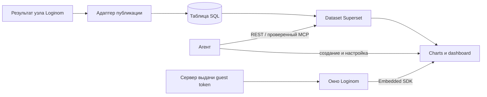

# Apache Superset против DataLens для интеграции с Loginom

Дата проверки: 2026-11-03. Сравниваются Apache Superset и открытая поставка DataLens. Cloud/Enterprise DataLens рассматриваются отдельно, поскольку их возможности нельзя автоматически приписывать OSS.

## Решение

**Для сценария «агент создаёт полноценный BI dashboard, Loginom показывает его внутри своего клиента» Superset выглядит предпочтительнее DataLens OSS.** Главные причины — публичный API объектов и штатное приватное встраивание уже находятся в открытой поставке. Это вывод из документации и исходников, а не из выполненного end-to-end теста.

Ограничения этого вывода:

- Оба продукта — серверные BI-системы. Они не заменяют лёгкий браузерный движок, принимающий строки узла напрямую.
- Стандартный guest-token embedding Superset даёт просмотр и интерактивные фильтры. Полный редактор требует отдельного пользовательского доступа.
- Встроенный MCP Superset действительно умеет строить dashboard, но у версии 6.1.0 есть существенное расхождение между документацией JWT-auth и разрешением пользователя в коде. Для первого прототипа разумнее опереться на REST.
- Удобство ручной работы двух интерфейсов на одинаковом сценарии здесь не измерялось.

Сведения о DataLens из [предыдущего исследования](/home/kiselev/.codex/worktrees/2704/loginom-ai-agent/docs/research/2026-11-03-datalens-loginom.md) дополнены повторной проверкой ключевых исходников.

## Версии и глубина проверки

GitHub `/releases/latest` на дату исследования ведёт на **Superset 6.1.0**, опубликованный 13 мая 2026 года; commit `c83fb2bb1dcfac41ac51bcebd82471f4a7180d18`. Проверялись исходники этого тега, версия документации 6.1.0 и отдельно отличия документации Next. [Релиз](https://github.com/apache/superset/releases/tag/6.1.0).

База сравнения DataLens — OSS-дистрибутив v2.9.0 с UI `0.3831.0`. Его SDK заявляет поддержку Cloud и Enterprise. [Версии DataLens](https://github.com/datalens-tech/datalens/blob/1cebb39b37e3ccd879f43ba17d96d98fb90c85ab/versions-config.json), [SDK](https://github.com/datalens-tech/datalens-sdk#readme).

Контейнеры не устанавливались и не запускались. Проверка включала документацию, схемы REST, регистрацию API, Embedded SDK, код MCP и материалы об известных проблемах. GitHub REST API ответил rate-limit, поэтому использованы публичные страницы GitHub, raw-исходники и официальная документация; это не помешало проверить ключевые возможности. Реальные данные Loginom, производительность и браузерная интеграция не проверялись.

## 1. Автоматическое создание объектов: преимущество Superset

В Superset есть публичные операции создания database connection, dataset, chart и dashboard; есть получение данных графика, настройка embedded-конфигурации и импорт/экспорт связанных объектов. Это API самого OSS-продукта. В инициализации 6.1.0 действительно регистрируются `ChartRestApi`, `DashboardRestApi`, `DatasetRestApi`, `DatabaseRestApi`, `EmbeddedDashboardRestApi` и `SecurityRestApi`. [API 6.1.0](https://superset.apache.org/developer-docs/6.1.0/api/), [регистрация API](https://github.com/apache/superset/blob/c83fb2bb1dcfac41ac51bcebd82471f4a7180d18/superset/initialization/__init__.py).

Прочитанные схемы подтверждают, что агенту доступны необходимые части:

- Dataset: database, schema/table либо SQL виртуального датасета.
- Chart: тип визуализации, datasource, JSON `params`, query context, связанные dashboards.
- Dashboard: название, владельцы, публикация, JSON расположения `position_json` и метаданные; метаданные включают конфигурацию native filters и cross-filter scoping.

Источники: [dataset schema](https://github.com/apache/superset/blob/6.1.0/superset/datasets/schemas.py), [chart schema](https://github.com/apache/superset/blob/6.1.0/superset/charts/schemas.py), [dashboard schema](https://github.com/apache/superset/blob/6.1.0/superset/dashboards/schemas.py).

Это не готовый универсальный язык dashboard: `params` зависят от chart plugin, а раскладку и фильтры нужно создавать согласованно. Но адаптер может использовать поддерживаемые API вместо воспроизведения приватных запросов UI. HTTP 201 сам по себе не подтверждает правильные метрики или успешный рендер.

В DataLens OSS прочитанный маршрутизатор содержит gateway и внутренние маршруты переноса workbooks, но не подключает современный публичный RPC-контракт, под который рассчитан SDK. Автоматизация возможна через собственный адаптер, однако её путь менее готов. Это статическое наблюдение именно проверенной OSS-сборки, а не утверждение о невозможности API в любой модификации DataLens. [Маршруты DataLens](https://github.com/datalens-tech/datalens-ui/blob/v0.3831.0/src/server/modes/opensource/routes.ts), [заявленная поддержка SDK](https://github.com/datalens-tech/datalens-sdk#readme).

**Оценка для нашей задачи:** Superset уменьшает число неизвестных в автоматическом создании объектов. Преимущество относится к сравнению OSS с OSS; у DataLens Enterprise/Cloud SDK даёт другой, более готовый вариант.

## 2. Встраивание: наиболее весомое преимущество Superset

В открытом репозитории поставляется `@superset-ui/embedded-sdk`. Его `embedDashboard` создаёт iframe в переданном DOM-контейнере. Host-приложение передаёт функцию получения guest token; пользователю не требуется отдельно входить в Superset ради просмотра разрешённого dashboard. Включается флаг `EMBEDDED_SUPERSET`, настраиваются разрешённые origins и выдача токенов. [Документация 6.1.0](https://superset.apache.org/user-docs/6.1.0/using-superset/embedding/), [SDK в релизе](https://github.com/apache/superset/blob/6.1.0/superset-embedded-sdk/README.md).

Предлагаемый путь в Loginom:

1. Кнопка узла получает сохранённую привязку dashboard.
2. Серверный адаптер проверяет доступ пользователя Loginom и получает ограниченный guest token.
3. Небольшой JS-модуль вызывает `embedDashboard` внутри окна/панели Loginom.
4. SDK передаёт токен iframe и обновляет его через callback.

Это проект интеграции, пока не реализованный. Штатный endpoint выдачи — `/api/v1/security/guest_token/`; сервисные доступы остаются на сервере. Embedded UUID следует хранить отдельно от числового dashboard ID. [Security API](https://github.com/apache/superset/blob/6.1.0/superset/security/api.py), [SDK source](https://github.com/apache/superset/blob/6.1.0/superset-embedded-sdk/src/index.ts).

Проверка origin действительно есть в `embedded/view.py`: непустой список `allowed_domains` сравнивается с referrer. Пустой список не ограничивает origin, поэтому одной галочки embedding недостаточно для настройки доступа. Guest token ограничивает ресурсы и может содержать RLS-условия; пользовательские URL-фильтры не должны заменять серверные ограничения. [Embedded view](https://github.com/apache/superset/blob/6.1.0/superset/embedded/view.py), [параметры guest token](https://github.com/apache/superset/blob/6.1.0/superset-embedded-sdk/README.md).

Для DataLens OSS ранее выявлены выключенный `EnableEmbedsInDialogShare` и отсутствие подключения соответствующих `/embeds/...` маршрутов в стандартном UI. Документированный cloud JWT-пример нельзя автоматически использовать как доказательство готовности OSS. [Флаг DataLens](https://github.com/datalens-tech/datalens-ui/blob/v0.3831.0/src/server/components/features/features-list/EnableEmbedsInDialogShare.ts), [cloud-пример](https://github.com/datalens-tech/datalens-examples/blob/main/04-How-to-embed-Datalens-into-your-website-using-secure-embedding-technology/main.py).

**Оценка:** у Superset есть значительно более прямой штатный путь для безопасного embedded-просмотра в нашем продукте.

### Просмотр не равен редактированию

Embedded SDK не является готовым встраиваемым конструктором. Обычный guest использует ограниченную роль для просмотра; Public не имеет операций записи объектов. Для ручного изменения нужен полноценный пользователь Superset с подходящими правами и сессией/SSO. Встраивание полного авторизованного редактора — отдельная проверка cookies, CSP, навигации и прав. [Security 6.1.0](https://superset.apache.org/admin-docs/6.1.0/security/).

Для первого прототипа можно разделить embedded-просмотр и открытие редактора в полном Superset. Но если обязательное требование — редактировать прямо внутри Loginom, этот вариант не следует считать готовым выполнением требования.

### Опубликованный SDK и исходник server-тега различаются

Проверен npm `@superset-ui/embedded-sdk@0.4.0`, Apache-2.0, gitHead `a7c0f4b83dea14becc499eb24a71de2ae065f5db`. В его опубликованном `lib/index.js` есть остановка refresh timer при unmount, которой нет в прочитанном SDK-коде тега 6.1.0. Это важно для многократного открытия dashboard в долго живущем клиенте Loginom. Совместимость конкретной пары server/SDK надо проверить; наличие метода в новом SDK не доказывает его поддержку старым iframe. [Метаданные пакета](https://registry.npmjs.org/%40superset-ui%2Fembedded-sdk/0.4.0), [опубликованный код](https://unpkg.com/@superset-ui/embedded-sdk@0.4.0/lib/index.js).

## 3. Агент и MCP: готовые инструменты есть, но нужна осторожность с версией

В Superset 6.1.0 действительно есть собственный `mcp_service`, а не только сторонние обёртки. Он выполняется отдельным процессом рядом с Superset и использует его контекст, конфигурацию и модель доступа. Это не просто REST-прокси, который достаточно направить на произвольный URL. [Admin guide тега](https://github.com/apache/superset/blob/6.1.0/docs/admin_docs/configuration/mcp-server.mdx).

Прочитаны конкретные инструменты:

- `get_chart_type_schema`: возвращает JSON Schema и примеры поддерживаемых типов, включая xy, table, pie, pivot_table, mixed_timeseries, handlebars, big_number.
- `generate_chart`: принимает упрощённую конфигурацию, по умолчанию создаёт preview; для сохранения нужен `save_chart=True`. В коде есть небольшое пробное выполнение запроса. Это не проверка всей бизнес-логики и не точный браузерный скриншот.
- `generate_dashboard`: собирает существующие charts, проверяет доступ к их данным и формирует реальную иерархию раскладки. В прочитанной реализации автокомпозиция — простая сетка в две колонки.

Источники: [schema tool](https://github.com/apache/superset/blob/6.1.0/superset/mcp_service/chart/tool/get_chart_type_schema.py), [generate_chart](https://github.com/apache/superset/blob/6.1.0/superset/mcp_service/chart/tool/generate_chart.py), [generate_dashboard](https://github.com/apache/superset/blob/6.1.0/superset/mcp_service/dashboard/tool/generate_dashboard.py).

Это серьёзное сокращение объёма собственного кода для агента. Но «MCP умеет создавать dashboard» не означает готовое оформление любой страницы и любые фильтры без дополнительной настройки.

### Подтверждённая проблема auth в 6.1.0

В `get_user_from_request()` тега 6.1.0 разрешение пользователя ищет уже установленный `g.user`, затем `MCP_DEV_USERNAME`. Описываемый новой документацией путь разрешения идентичности из JWT claims там не реализован таким же образом. Соответствующий upstream issue сообщает о `No authenticated user found`. [Auth 6.1.0](https://github.com/apache/superset/blob/c83fb2bb1dcfac41ac51bcebd82471f4a7180d18/superset/mcp_service/auth.py), [issue #40225](https://github.com/apache/superset/issues/40225), [дополнительное обсуждение](https://github.com/apache/superset/discussions/45457).

В master auth-код существенно расширен. Нельзя приписывать его поведение установленному 6.1.0 или заменять многопользовательскую авторизацию одним фиксированным admin. Поэтому моя рекомендация для первого проверочного пути — REST; MCP подключать после проверки версии и реального разрешения пользователя. Это не препятствие для выбора Superset, поскольку основной REST-контракт существует независимо от MCP.

### AI Skills

У DataLens подтверждена официальная коллекция skills с инструкциями SDK; это его преимущество как источника готового workflow. Но её применимость к OSS ограничена поддержкой SDK. [DataLens skills](https://github.com/datalens-tech/datalens-skills).

В выполненном поиске сопоставимый официальный прикладной SKILL.md создания dashboard именно Apache Superset не подтверждён. Найден сторонний Membrane skill, но он добавляет внешний сервис и не заменяет предметную логику построения dashboard. Популярные карточки `superset`/`superset-mcp` от `superset-sh` относятся к другому продукту для coding agents. Их нельзя считать навыками Apache BI. [Membrane skill](https://github.com/membranedev/application-skills/blob/main/skills/apache-superset/SKILL.md), [пример одноимённого другого продукта](https://skills.sh/superset-sh/skills/superset).

Для нашей задачи можно писать узкий Loginom Skill поверх REST или проверенного native MCP, используя существующие схемы и инструменты Superset. Отсутствие найденного готового skill не перевешивает API/embedding-возможности.

## 4. Данные узла: преимущество над DataLens здесь небольшое

Superset — тонкий слой над SQL-источником: график инициирует запрос к источнику, результат отображается в UI. Dataset создаётся над таблицей/view или SQL. Штатный Embedded SDK не является интерфейсом загрузки произвольной таблицы Loginom в BI-движок. [Архитектура](https://superset.apache.org/admin-docs/6.1.0/installation/architecture/), [DatasetPostSchema](https://github.com/apache/superset/blob/6.1.0/superset/datasets/schemas.py).

Поэтому реалистичный путь всей платформы такой же, как для DataLens:

Для произвольного результата Loginom потребуется механизм публикации. Поддержку нужного SQL-экспорта текущим агентом Loginom в этом исследовании не проверяли и не предполагаем автоматически. Если результат уже находится в доступной БД, можно использовать существующую таблицу и избежать лишнего копирования.

В Superset есть CSV upload, но он относится к загрузке данных в настроенное хранилище; это не аргумент в пользу frontend-only архитектуры. Для регулярно обновляемых результатов узла практичнее проверить прямую публикацию со стабильной таблицей/схемой. [FAQ и upload](https://superset.apache.org/user-docs/6.1.0/faq/).

Обновление результата узла и обновление dashboard — разные операции. Нужно обновить источник, затем учитывать кеш и запросить актуальные chart data. Смена схемы может потребовать refresh колонок dataset и изменения зависимых чартов. Эти связи не возникают сами после добавления кнопки Loginom. [FAQ о схеме и refresh](https://superset.apache.org/user-docs/6.1.0/faq/).

**Оценка:** если SQL-публикация нежелательна и нужно работать только с текущим браузерным DataSource, ни Superset, ни вся платформа DataLens не являются первым выбором.

## 5. Ручная аналитика: DataLens сохраняет конкретные преимущества

Superset имеет визуальный chart builder, SQL Lab, сохранённые метрики, фильтры и редактор dashboard. Но Explore работает над одним логическим dataset; соединения таблиц обычно выполняются SQL/view или заранее в обработке данных. [README](https://github.com/apache/superset), [FAQ 6.1.0](https://superset.apache.org/user-docs/6.1.0/faq/).

В DataLens источники и связи таблиц можно настраивать на странице датасета. Если пользователь должен самостоятельно моделировать несколько таблиц без SQL, это существенное отличие в пользу DataLens. Для уже подготовленной плоской таблицы результата Loginom значение этого преимущества уменьшается: сложные joins можно оставить самому Loginom. [DataLens dataset UI](https://github.com/datalens-tech/datalens-docs/blob/05fc067a66536f03cc540b27a3c2b9107f99f873/ru/datalens/dataset/index.md).

Русский перевод Superset предусмотрен, но в config 6.1.0 после перечня языков стоит `LANGUAGES = {}` с комментарием о неполных переводах. Его нужно включать конфигурацией; нельзя считать качество русской локализации равным DataLens без живого сравнения. [Config](https://github.com/apache/superset/blob/6.1.0/superset/config.py).

Это не доказательство, что один UI удобнее другого в целом. Проверка одинакового сценария пользователем в двух интерфейсах остаётся невыполненной.

## 6. Доступ и эксплуатация

У Superset в OSS есть RBAC, доступ к источникам, RLS и настройка аутентификации через Flask AppBuilder. В guest token задаются разрешённые dashboard и при необходимости ограничения строк. У DataLens OSS описанная в основном README модель значительно проще: viewer читает все workbooks, editor меняет все объекты. При необходимости разных прав пользователей на результаты узлов Superset предоставляет больше готовых механизмов, хотя сопоставление с правами Loginom всё равно наше. [Security Superset](https://superset.apache.org/admin-docs/6.1.0/security/), [DataLens authentication](https://github.com/datalens-tech/datalens#authentication).

Эксплуатационно Superset остаётся отдельным сервисом с Python/Flask backend, React frontend и metadata DB. Redis/cache и Celery worker/beat нужны для соответствующих функций; для каждого базового просмотра все опциональные компоненты не обязательны. Штатный non-dev Compose включает Redis, PostgreSQL, web и workers. По одному количеству контейнеров нельзя заключать, что Superset проще или дешевле DataLens. [Архитектура](https://superset.apache.org/admin-docs/6.1.0/installation/architecture/), [Compose](https://github.com/apache/superset/blob/6.1.0/docker-compose-non-dev.yml).

FAQ Superset приводит community-ориентир 8 ГБ RAM/2 vCPU для умеренной нагрузки, а DataLens — минимальную конфигурацию 4 ГБ/2 CPU. Это разные методики и нагрузки: вывод «Superset потребляет вдвое больше» не обоснован. [FAQ Superset](https://superset.apache.org/user-docs/6.1.0/faq/), [README DataLens](https://github.com/datalens-tech/datalens#readme).

Оба основных проекта — Apache-2.0. Нельзя объявлять Superset победителем только из-за Highcharts: у DataLens он опционален и основные Gravity Charts доступны без него. Здесь преимущество Superset — доступность нужных API и embedding в OSS, а не общий ярлык лицензии. [Superset LICENSE](https://github.com/apache/superset/blob/6.1.0/LICENSE.txt), [DataLens LICENSE](https://github.com/datalens-tech/datalens/blob/main/LICENSE), [Gravity Charts без HC](https://github.com/datalens-tech/datalens-ui/blob/v0.3831.0/src/server/components/features/features-list/GravityChartsForLineAreaAndBarX.ts).

## Что потребуется сделать для Loginom

Остающийся объём работ для варианта Superset:

1. Действия меню и toolbar, окно/панель dashboard в клиенте Loginom.
2. Получение результата узла и публикация в поддерживаемый SQL-источник.
3. Привязка узла/выхода к dataset, chart IDs, dashboard ID и embedded UUID; повторное открытие должно использовать ту же привязку.
4. Инструменты агента для выбора полей/метрик, создания согласованных объектов и read-back проверки.
5. Аутентифицированный серверный endpoint выдачи ограниченных guest token.
6. Обновление опубликованных данных, учёт кеша и проверка отображаемого результата.
7. Отдельный способ ручного редактирования, если пользователь должен редактировать внутри Loginom.

Это предлагаемая интеграция. Она не реализована ни Superset, ни ранее изученным кодом Loginom автоматически.

## Минимальный эксперимент, который решит выбор

Для основного пути сначала достаточно REST, SQL-источника и Embedded SDK; MCP не должен быть обязательной зависимостью первого доказательства.

- Взять небольшой результат узла с известными ожидаемыми агрегатами и опубликовать его в БД.
- Создать dataset, KPI/таблицу и график, раскладку с общим фильтром через API; прочитать объекты обратно и проверить chart data.
- Показать тот же dashboard в Loginom через ограниченный guest token. Проверить разрешённый и запрещённый доступ.
- Изменить результат узла и убедиться, что обновляется тот же dashboard, а не создаётся копия и не остаются старые значения из кеша.
- Проверить выбранный способ ручного редактирования и многократное открытие/закрытие окна.

Если этот путь работает, **для OSS-интеграции я бы выбрал Superset раньше DataLens OSS**. DataLens остаётся сильным вариантом, когда приоритетны его моделирование данных и пользовательский интерфейс либо доступна поддерживаемая Enterprise/Cloud-установка. Если цель — только браузерный dashboard без серверной публикации, выбирать следует другой класс инструментов.
