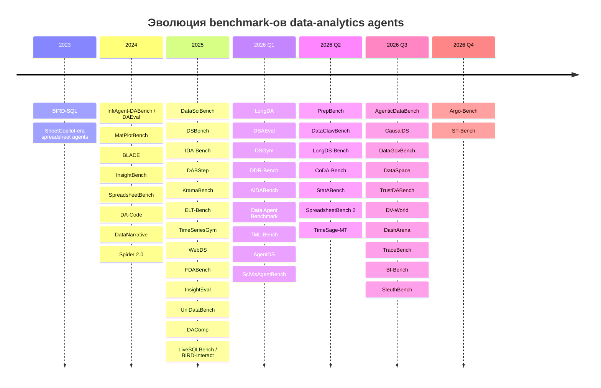
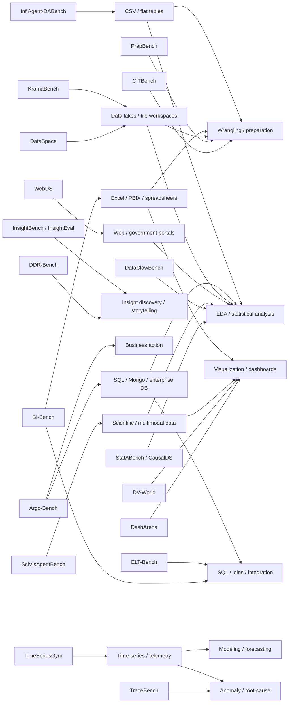

# Бенчмарки AI-агентов для аналитики данных: ландшафт, методологии и пробелы на октябрь 2026 года

## Резюме для руководителей

Рынок оценивания AI-агентов для работы с данными за последние три года прошёл несколько стадий. В 2024 году основным объектом проверки был агент, который получает CSV/таблицу, пишет Python или SQL и возвращает числовой ответ либо график: **InfiAgent-DABench/DAEval, DA-Code, MatPlotBench, BLADE, InsightBench**. В 2025 году фокус сместился к полноценным data-science и data-engineering workflows: **DSBench, DataSciBench, DABStep, KramaBench, ELT-Bench, WebDS, FDABench, InsightEval**. В 2026 году появились существенно более реалистичные среды — большие data lakes и enterprise warehouses, поиск неизвестных заранее источников, долговременный интерактивный анализ, BI, dashboards, time series, причинный анализ и оценивание последствий действий агента: **AIDABench, DSAEval, Data Agent Benchmark, DataClawBench, LongDS-Bench, AgenticDataBench, DataSpace, BI-Bench, Argo-Bench, PrepBench, CITBench, DV-World, TraceBench, SleuthBench**. citeturn0search6turn17search1turn19view7turn21search3

В максимально широком понимании «data-analytics agent benchmark» я обнаружил **около пятидесяти явно agent-oriented benchmark/evaluation suites и ещё порядка двух десятков смежных benchmark families**, которые проверяют критические для агента подспособности — text-to-SQL, spreadsheets, визуализацию, statistical reasoning, time-series/anomaly analysis и data storytelling. Это не означает, что все пятьдесят являются прямыми конкурентами: сравнивать, например, TraceBench с BI-Bench или PrepBench бессмысленно без учёта того, какую часть аналитического workflow они изолируют. Многие старые SQL/viz benchmarks также не являются «агентными» в строгом смысле; ниже они отделены от benchmarks, в которых субъект оценки действительно действует итеративно через tools/environment.

Наиболее важный структурный сдвиг — **от оценки артефакта к оценке процесса и результата деятельности**. DAEval и ранние аналоги в основном проверяют конечный аналитический ответ; DABStep делает ответы автоматически проверяемыми через factoids; DataClawBench оценивает ещё и промежуточные milestones; LongDS-Bench проверяет сохранение и изменение аналитического состояния на протяжении многих ходов; DashArena требует не только dashboard, но и воспроизводимую interaction trajectory; наконец, Argo-Bench оценивает *последствие* действия в симулированной компании, а не совпадение SQL-кода с эталоном. citeturn0search24turn19view6turn17search5turn15search1turn21search26

Для выбора benchmark stack сегодня я бы выделил следующие «якоря»:

| Цель оценки | Наиболее показательные benchmarks |
|---|---|
| Универсальный data analyst / data scientist | **AIDABench, DSAEval, DataSciBench, DSBench, AgenticDataBench, InfiAgent-DABench** |
| Реальная exploratory analysis | **DataClawBench, DDR-Bench, InsightBench, InsightEval, SleuthBench, DTR-Bench** |
| Enterprise BI | **BI-Bench, Argo-Bench, Data Agent Benchmark, DA-bench** |
| Data lake / неизвестные файлы и источники | **KramaBench, DataSpace, CoDA-Bench, WebDS, LongDA** |
| Wrangling / preparation / ETL | **PrepBench, CITBench, ELT-Bench, DA-Code** |
| SQL / database agents | **BIRD-Interact, Spider 2.0, LiveSQLBench, Data Agent Benchmark, BI-Bench** |
| Visualization / dashboards | **DV-World, SciVisAgentBench, DashArena, MatPlotBench, SpreadsheetBench 2** |
| Long-horizon conversational analytics | **LongDS-Bench, IDA-Bench, CITBench, TimeSage-MT** |
| Time series / anomaly / root cause | **TimeSeriesGym, TraceBench, TimeSage-MT**; SHAD — важный, но не agent-native benchmark |
| Statistical / causal analysis | **StatABench, CausalDS, SleuthBench, DSGym/QRData-Verified** |
| Data storytelling / insight discovery | **InsightBench, InsightEval, DDR-Bench, DataNarrative** |
| Надёжность и robustness | **TrustDABench, SleuthBench, DSGym verified subsets** |

С практической точки зрения наиболее серьёзный пробел поля в 2026 году — **нет одного стандарта, который одновременно измерял бы правильность анализа, качество data preparation, SQL, статистическую методологию, визуализацию, объяснимость, provenance, uncertainty/calibration, интерактивность, стоимость и business consequence**. Даже наиболее широкие AgenticDataBench, AIDABench и DSAEval закрывают лишь часть этих измерений, а Argo-Bench, несмотря на исключительно реалистичную enterprise-среду, намеренно концентрируется на одной симулированной компании. citeturn19view7turn8search0turn17search13turn21search3

Ещё один существенный вывод: **проблема уже не сводится к качеству базовой LLM**. WebDS показывает огромный разрыв между web/data-science агентами и людьми; LongDS-Bench выявляет деградацию по мере удлинения диалога; BI-Bench показывает, что специальные search/join/transform tools значительно поднимают accuracy; TimeSeriesGym и DataSpace подчёркивают влияние harness/environment; то есть leaderboard фактически измеряет сочетание **model × agent harness × tools × environment × evaluator**, а не «модель» как таковую. citeturn19view5turn17search5turn16view3turn14view2turn9search0

В ходе поиска официальных русскоязычных спецификаций этих benchmark suites обнаружить не удалось. Поэтому ниже опора сделана почти исключительно на статьи авторов, официальные project pages, benchmark repositories и официальные leaderboards; русскоязычные пересказы намеренно не используются вместо первоисточников.

## Границы исследования и таксономия

Я использую слово **агент** в строгом смысле, когда система может хотя бы частично выбирать последовательность действий: читать данные/схему, вызывать Python, SQL, shell, browser или специализированные tools, наблюдать результат исполнения, менять план и продолжать работу. Это отличает agent benchmark от обычного single-turn question answering или code generation.

Поэтому реестр разбит на два слоя.

**Agent-native benchmarks** непосредственно оценивают автономный или интерактивный workflow. К ним относятся InfiAgent-DABench, DABStep, KramaBench, WebDS, AIDABench, DataClawBench, Argo-Bench, TraceBench, BI-Bench и т. п. Например, WebDS содержит 870 задач на 29 data-rich websites и существует как live- и dockerized-track; DataClawBench запускает агента в изолированном Docker-контейнере, где тот сам должен найти необходимые источники среди примерно 2,06 млн записей; Argo-Bench предоставляет warehouse из 235 таблиц и 7,5 млрд строк, после чего агент должен совершить business action. citeturn19view5turn19view6turn21search3

**Agent-adjacent capability benchmarks** изначально могут оценивать модель или generated artifact, но критически важны для современных data agents: BIRD/Spider для SQL, VisEval/NVBench/Text2Vis для visual encoding, SHAD для anomaly detection, QRData для статистики и causal reasoning, DashboardMimic для dashboard code и т. д. Их нельзя смешивать в едином leaderboard с agent-native suites, но исключать их из обзора тоже нельзя: они являются фактически unit-tests для отдельных частей агента. DSGym, например, прямо объединяет исправленные **DAEval-Verified** и **QRData-Verified**, DABStep и prediction benchmark в единую среду. citeturn19view0

По содержанию benchmark landscape распадается на следующие функциональные слои:

**ingestion/discovery → preparation/wrangling → integration/SQL → descriptive/EDA → statistical/causal reasoning → modeling/forecasting → visualization/dashboarding → insights/storytelling → business action.**

AgenticDataBench формализует почти ту же структуру через семь классов skills: format handling, preprocessing, manipulation, analysis, modeling, visualization и cross-stage skills, включая SQL/database и environment management. citeturn19view7

Это важная оговорка для слова «все»: если включить любой benchmark, содержащий таблицу или график, список становится практически безграничным — туда попадут WikiSQL, TabFact, PlotQA, огромный массив forecasting benchmarks и сотни tabular-ML datasets. В основной census ниже включены suites, где **аналитическая деятельность сама является объектом оценки**. Старые static benchmarks приведены отдельно только там, где они продолжают играть роль в agent evaluation.

## Каталог agent-native benchmarks

Ниже — максимально полный публичный census по состоянию на **27 октября 2026 года**. «Лицензия не подтверждена» означает именно отсутствие надёжно подтверждённой лицензии в изученном paper/project metadata, а не отсутствие разрешения на использование.

| Benchmark | Год, авторы / maintainer | Scope, задачи и данные | Метрики и evaluation protocol | Agent interface / пример | Сильные стороны / ограничения | Primary links |
|---|---|---|---|---|---|---|
| **InfiAgent-DABench / DAEval** | 2024, Xueyu Hu et al.; InfiAgent | Один из первых benchmarks, специально сформулированных для LLM-based data-analysis agents: **257 вопросов по 52 CSV**; end-to-end computation, aggregation, статистика и анализ. citeturn0search6 | Авторы превращают открытые вопросы в автоматически проверяемые closed-form outputs через format prompting; оценивается конечная корректность после исполнения. | Агент получает файл и вопрос, генерирует/исполняет анализ в environment; baseline — DAAgent. Пример класса задачи: вычислить бизнес/статистический показатель после фильтрации и агрегации. | **+** воспроизводимый execution-grounded baseline; **−** сравнительно маленькие CSV и короткий аналитический горизонт по современным меркам. | [paper](https://arxiv.org/abs/2401.05507), [repo](https://github.com/InfiAgent/InfiAgent) |
| **DA-Code** | 2024, Yiming Huang et al.; CASIA-led team | 500 executable data-science code tasks; включает wrangling, EDA и ML; агент должен работать с реальными файлами, а не только написать фрагмент кода. citeturn1search36turn4search17 | Execution-based проверки результатов; для таблиц/графиков — структурная/визуальная корректность, для ML — task-specific metrics. | Python, SQL и shell/Bash в executable environment; DA-Agent baseline. | **+** хорошо проверяет tool-grounded coding; **−** код и конечный artifact важнее качества аналитического объяснения. | [paper](https://arxiv.org/abs/2410.07331) |
| **InsightBench** | 2024; Gaurav Sahu et al.; ServiceNow Research/Mila | End-to-end insight discovery: **100 datasets**, различные business use cases; опубликованные подсчёты benchmark test sets указывают **475 target insights**. citeturn6search1turn21search28 | Two-way LLM-based evaluation сопоставляет найденные и reference insights; оценивается содержательная полнота аналитики, а не только число. | AgentPoirot последовательно формулирует descriptive, diagnostic, predictive и prescriptive questions и анализирует данные. | **+** один из наиболее релевантных benchmarks для EDA/insight generation; **−** зависимость от semantic/LLM evaluator и от заранее curated insight set. | [paper](https://arxiv.org/abs/2407.06423), [repo](https://github.com/ServiceNow/insight-bench) |
| **DSBench** | 2024 preprint / ICLR 2025; Liqiang Jing et al. | **466 data-analysis + 74 modeling tasks** из реальных источников, включая Eloquence и Kaggle; длинные contexts, несколько таблиц, multimodal background, большие файлы. citeturn6search0turn6search4 | Для analysis — executable/result correctness; для modeling — performance относительно competition targets; benchmark показывает очень низкие абсолютные результаты агентов. | Data-science agent работает с файлами и кодовой средой end-to-end. | **+** реалистичнее ранних CSV QA; **−** aggregation разных task families затрудняет интерпретацию единого score. | [paper](https://arxiv.org/abs/2409.07703) |
| **SpreadsheetBench** | 2024, Zeyao Ma et al. | **912** реальных вопросов с Excel-форумов; сложные workbooks с несколькими таблицами, нестандартными связями и non-text elements. citeturn6search2turn6search6 | Online-judge-style: один instruction проверяется на нескольких spreadsheet test files; предусмотрены single- и multi-round settings. | Агент/модель редактирует spreadsheet artifact, а не просто отвечает текстом. | **+** реальный spreadsheet workflow; **−** исходная версия слабее покрывает полноценный dashboard/debug lifecycle, что исправляет SpreadsheetBench 2. | [paper](https://arxiv.org/abs/2406.14991) |
| **MatPlotBench** | 2024, Zhiyu Yang et al. | **100 human-verified scientific visualization tasks**; цель — получить требуемый plot из данных/описания. citeturn6search3turn6search7 | GPT-4V-based scorer сравнивает generated plot с ground truth по шкале 0–100; авторы валидируют корреляцию с людьми. | MatPlotAgent: query understanding → code generation → debugging → visual feedback. | **+** явная visual feedback loop; **−** judge-based visual score и focus на статические scientific plots, не dashboards. | [paper](https://arxiv.org/abs/2402.11453) |
| **BLADE** | 2024, Ken Gu et al. | Benchmarking Language Model Agents for Data-Driven Science: статистический анализ и выбор аналитических решений, а не только воспроизведение числа. Работа опубликована в Findings of EMNLP 2024. citeturn20search6 | Сопоставление ключевых statistical/data-analysis decisions и результатов с reference analysis. | Coding/data-analysis agents. | **+** измеряет качество методологических решений; **−** научный statistical-analysis setting уже, чем enterprise BI. | Библиография и paper приведены в официальной литературе Data World. citeturn20search6 |
| **DataNarrative** | 2024 | Benchmark multimodal data-story generation: **1 449 data stories**, где необходимо совместить анализ, текст и визуализацию. citeturn5search32 | Agent-based generator/evaluator; оценивается multimodal story относительно аналитического и визуального содержания. | Анализ данных → charts → связный narrative. | **+** редкий benchmark именно для data storytelling; **−** open-ended output делает автоматическую оценку значительно менее детерминированной. | [paper](https://arxiv.org/abs/2408.05346) |
| **DataSciBench** | 2025, Dan Zhang et al.; THUDM/Caltech collaborators | Широкий data-science benchmark с естественными сложными prompts и executable ground truth; paper вводит Task–Function–Code framework. citeturn0search0turn4search5 | TFC rules, execution tests и, где необходимо, multimodal/LLM judging; ground truth строится semi-automatically и проходит human verification. | Python sandbox, data-science packages, plotting/ML libraries. | **+** fine-grained programmatic evaluation; **−** часть задачи качества определяется correctness rules, которые труднее задать для truly exploratory analysis. | [paper](https://arxiv.org/abs/2502.13897), [repo](https://github.com/THUDM/DataSciBench) |
| **IDA-Bench** | 2025 | Interactive / guided data analysis: пользователь в нескольких раундах уточняет требования и субъективные domain insights; benchmark проверяет адаптацию анализа по ходу разговора. citeturn4search29turn0search32 | Выполненные результаты сравниваются с reference/human outputs; используются task-dependent accuracy/numeric errors. | Python/data-analysis environment + LLM user simulator. | **+** интерактивность и evolving intent; **−** simulator не полностью воспроизводит поведение живого analyst stakeholder. | [paper](https://arxiv.org/abs/2505.18223) |
| **DABStep** | 2025, Alexander Egg et al. | Более **450** многошаговых задач, построенных из реальных операционных workloads Adyen; включает большой payment dataset и несколько файлов. citeturn0search24turn1search30 | **Factoid Evaluation Framework**: итог разбивается на однозначно проверяемые facts, что позволяет давать форматно гибкие ответы и сохранять binary correctness. | Аналитический coding agent с file/Python access. | **+** великолепный компромисс между реализмом и автоматическим grading; **−** factoid decomposition хуже оценивает качество открытого exploratory narrative. | [paper](https://arxiv.org/abs/2506.23719) |
| **KramaBench** | 2025, Eugenie Lai et al.; MIT CSAIL/MIT Data Systems | **104** вручную curated data-to-insight pipelines, около **1 700 файлов, 24 источников, 6 domains**. Требуются discovery, integration, wrangling, computation и statistical reasoning. citeturn7search2turn7search6 | End-to-end outcome и pipeline-level executable checks; reference pipelines используются для reproducibility. | DS-GURU baseline; filesystem/data-lake style interaction и Python. | **+** одна из лучших проверок data-lake navigation; **−** expensive benchmark, а 104 pipelines дают меньшую статистическую мощность, чем массовые QA sets. | [paper](https://arxiv.org/abs/2506.06541), [repo](https://github.com/mitdbg/KramaBench) |
| **ELT-Bench** | 2025, Tengjun Jin, Yuxuan Zhu, Daniel Kang | **100 ELT pipelines, 835 source tables, 203 target data models**; extraction/loading + dbt-style transformations. citeturn7search3turn7search11 | Success Rate for Data Extraction/Loading и Data Transformation (**SRDEL/SRDT**); фактическое выполнение инфраструктуры. | Airbyte/Terraform/dbt, SQL, Snowflake/S3/PostgreSQL/MongoDB-like stack. | **+** редкий benchmark реального analytics engineering; **−** инфраструктурные failures могут смешиваться с reasoning failures. | [paper](https://arxiv.org/abs/2504.04808), [repo](https://github.com/uiuc-kang-lab/ETL) |
| **ELT-Bench-Verified** | 2026, те же maintainers | Исправленная версия после аудита: авторы обнаружили значительную долю benchmark-attributable failures; исправление заметно меняет измеряемый SRDT. citeturn7search7turn7search15 | Та же execution-based схема с исправленными tasks/environment. | Как ELT-Bench. | **+** хороший пример необходимости benchmark auditing; **−** показывает, насколько environment bugs способны искажать agent leaderboard. | [paper](https://arxiv.org/abs/2603.29399) |
| **KaggleBench / AgentAda** | 2025 | Реалистичные analytics/data-science задачи, отобранные из Kaggle; ориентирован на автономного data agent и несколько типов аналитических skills. citeturn0search30 | Task/competition dependent executable evaluation. | Coding/data-analysis agent. | **+** естественные задачи и данные; **−** Kaggle bias в сторону competition-style outcomes и риск contamination известных competitions. | [paper](https://arxiv.org/abs/2504.07421) |
| **FDABench** | 2025, Ziting Wang et al. | Analytical queries над heterogeneous data; измерения сложности включают data heterogeneity, task complexity, output diversity и workflow variability. citeturn0search1turn8search13 | Report-mode для insight generation и choice/numeric mode для точно проверяемых результатов. | Data-agent systems, semantic operators, RAG-style analytical systems. | **+** хорошо разделяет точный QA и открытые аналитические reports; **−** evaluator complexity и неоднородность output modes. | [paper](https://arxiv.org/abs/2509.02473) |
| **InsightEval** | 2025, Zhenghao Zhu et al. | Expert-curated benchmark именно для **insight discovery** data agents; не требует, чтобы агент лишь ответил на заранее сформулированный вопрос. citeturn21search12 | **Insight F1** плюс отдельная оценка novelty; авторы позиционируют это как способ измерять exploratory performance. citeturn21search12 | Open-ended analytical agent. | **+** лучше обычной QA оценивает ценность discovery; **−** definition of insight и expert reference set неизбежно неполны. | [paper](https://arxiv.org/abs/2511.22884) |
| **WebDS** | 2025, Ethan Hsu et al.; Stanford-led team | **870 human-written tasks на 29 data-rich websites**: government portals, news и др.; browsing, acquisition, cleaning, analysis и synthesis. citeturn18search4turn19view5 | Task success; два режима: live websites и reproducible dockerized environments. В paper нынешние agents достигают ≤13% против 90% human baseline. citeturn19view5 | Browser/web agent + heterogeneous data tools. | **+** end-to-end acquisition-to-analysis; **−** live track нестабилен, docker track постепенно устаревает относительно живого web. | [paper](https://arxiv.org/abs/2508.01222) |
| **UniDataBench** | 2025 | High-level business analytics над несколькими форматами данных; ReActInsight baseline делает cross-source linkage, hierarchical planning, code self-correction и adaptive visualization. citeturn0search11turn4search16 | Multi-dimensional end-to-end analytical evaluation. | ReAct-style agent + code/data tools. | **+** heterogeneous formats и business context; **−** меньше независимого adoption, чем у DABStep/DataSciBench. | [paper](https://arxiv.org/abs/2511.01625) |
| **DAComp** | 2025 | **210 tasks**, охватывающих data engineering и open-ended data analysis; industrial-style schemas в среднем имеют десятки tables/сотни columns, а DE solutions могут требовать repository-scale code. citeturn7search0turn7search4 | End-to-end correctness по двум жизненным циклам — engineering и analysis. | Repo/code/data environment. | **+** соединяет DE и DA вместо искусственного разделения; **−** сложный composite score. | [paper](https://arxiv.org/abs/2512.04324) |
| **LongDA** | 2026, Li et al. | **505 analytical queries из 17 публичных US national surveys**; агент должен читать огромную heterogeneous documentation, в среднем порядка сотен тысяч tokens, а затем вычислять ответ. citeturn18search16turn10search0 | Correctness конечного результата с контролируемым tool-assisted document/data workflow. | LongTA: document retrieval/access + code execution. | **+** изолирует реальную проблему «понять документацию перед анализом»; **−** bias к survey/statistical documentation workflows. | [paper](https://arxiv.org/abs/2601.02598) |
| **DSAEval** | 2026, Maojun Sun et al. | **641 real-world problems на 285 datasets**, включая structured data, text и images; multi-query interaction и multimodal perception. citeturn17search13turn8search3 | Отдельно оцениваются reasoning, code и final results; также efficiency/cost dimensions. | Autonomous data-science agent с code/tools и multimodal inputs. | **+** широкий охват и multi-dimensional score; **−** много метрик затрудняет сведение в одно число. | [paper](https://arxiv.org/abs/2601.13591) |
| **DSGym** | 2026 | Не столько новый dataset, сколько **унифицированный evaluation/training framework**: включает исправленные DAEval-Verified и QRData-Verified, DABStep и MLEBench-Lite. citeturn19view0 | Unified metric registry и standardized environment. | Общий data-science agent harness. | **+** позволяет сравнивать агенты через несколько skills при одинаковом harness; **−** наследует conceptual limitations составляющих benchmarks. | [paper](https://arxiv.org/abs/2601.16344) |
| **DDR-Bench** | 2026, Wei Liu, Peijie Yu, Michele Orini, Yali Du, Yulan He | Deep Data Research: агенту не дают фиксированный query path; он сам исследует large databases и извлекает значимые findings. Held-out использование benchmark указывает **291 tasks и 2 058 target insights**. citeturn21search17turn21search28 | Checklist-based verifiable insight evaluation. | SQL/Python-style autonomous exploration. | **+** напрямую тестирует investigatory intelligence; **−** reference insight checklist неизбежно недооценивает корректные, но непредусмотренные discoveries. | [paper](https://arxiv.org/abs/2602.02039), [repo](https://github.com/thinkwee/DDR_Bench) |
| **AIDABench** | 2026, Yibo Yang et al. | **600+ heterogeneous document analytical tasks**: spreadsheets, databases, reports, operational records; QA, visualization и file generation; несколько industries/job functions. citeturn8search0 | Task-aligned automatic evaluators; headline metric pass@1; tasks stratified по difficulty. | Tool-augmented end-to-end inference; агент читает/создаёт файлы и визуальные artifacts. | **+** один из самых широких enterprise analytics benchmarks; **−** heterogeneous evaluator suite затрудняет причинную диагностику ошибки. | [paper](https://arxiv.org/abs/2603.15636), [repo](https://github.com/MichaelYang-lyx/AIDABench) |
| **Data Agent Benchmark — DAB** | 2026, Ma et al. | **104 natural-language queries, 17 datasets, 4 DBMS, 6 industries**, сформированные с опорой на enterprise customers/use cases. citeturn8search1turn20search0 | pass@1 / final-answer correctness; лучший tested agent в первой версии решал около 57%. | Чётко заданные tools: `list_db`, SQL/Mongo `query_db`, `execute_python`, `return_answer`. citeturn20search0 | **+** реалистичный database-agent API; **−** 104 задания дают относительно широкий confidence interval и не покрывают visualization/storytelling. | [paper](https://arxiv.org/abs/2603.20576) |
| **DTR-Bench** | 2026 | Deep Tabular Research: **500 scenario-driven QA pairs** из curated Excel sheets RealHiTBench; correlation, inequality, anomaly detection, hypothesis tests; восемь personas. citeturn19view3 | Final analytical correctness при свободном выборе procedure. | Continual execution / tabular research agent. | **+** сложнее обычного table QA и включает настоящую статистику; **−** source spreadsheets происходят из уже существующего benchmark corpus. | Benchmark описан в [paper](https://arxiv.org/abs/2603.09151). |
| **TML-Bench** | 2026, Mykola Pinchuk | Tabular ML agents на **четырёх Kaggle competitions**, с явными time budgets 240/600/1200 s и повторными runs. citeturn17search10 | Competition metric + end-to-end reliability под временем; пять runs на task/model/budget. | Autonomous coding agent. | **+** измеряет performance/time/reliability; **−** всего четыре competitions и сильный Kaggle bias. | [paper](https://arxiv.org/abs/2603.05764) |
| **AgentDS** | 2026 | Benchmark **и competition**: 17 challenges в commerce, food production, healthcare, insurance, manufacturing и retail banking; сравнивает AI-only и human–AI teams. citeturn19view2 | Domain task metrics/competition scores; 29 teams и 80 участников дают человеческую сравнительную точку. | Autonomous agents или human+agent workflows. | **+** крайне редкий human-vs-agent experiment; **−** синтетические, хотя domain-grounded, datasets. citeturn19view2 | [paper](https://arxiv.org/abs/2603.19005), [project/data](https://agentds.org/) |
| **PrepBench** | 2026, J. Xu et al. | Natural-language data preparation из **Preppin' Data Challenges**; каждый task требует 3–18 steps; capabilities: interactive disambiguation, prep-code generation, code-to-workflow translation. citeturn14view0 | Три execution modes; ground-truth output/workflow и executable validation. | Raw tables + NL request; агент может уточнять ambiguous intent и генерировать executable prep logic. | **+** наиболее систематичный wrangling benchmark; **−** в основном structural/syntactic transformations, а не semantic domain cleaning. | [paper](https://arxiv.org/abs/2605.08687) |
| **DataClawBench** | 2026, Zhang et al. | **~2,06 млн real records и 492 expert-designed tasks**, объединяющих enterprise, industry и policy data в financial think-tank scenarios; native noise не удалён. citeturn19view6 | Outcome correctness **+ process milestones** для диагностики search/reasoning failures; agent runs isolated in Docker. | OpenClaw-style exploration: агент сам ищет нужные источники и выполняет numeric/text analysis. | **+** один из лучших EDA benchmarks без «подсказанной» схемы поиска; **−** domain concentration на finance/consulting. | [paper](https://arxiv.org/abs/2605.02503), [repo](https://github.com/GTML-LAB-sysu/DataClaw) |
| **LongDS-Bench** | 2026, K. Xu et al. | **68 tasks / 2 225 dialogue turns**, шесть domains; средний dependency span 11,3 turns; специально моделирует counterfactual changes, rollback и composition of states. citeturn10search5turn17search5 | Turn/final analytical correctness при необходимости сохранить верную evolving state. | Stateful multi-turn data agent. | **+** лучший специализированный тест long-horizon state management; **−** малое число underlying tasks при большом числе turns. | [paper](https://arxiv.org/abs/2605.30434), [repo](https://github.com/zjunlp/DataMind) |
| **CoDA-Bench / CODA-BENCH** | 2026, Zhang et al. | **1 009 tasks в 31 Kaggle community**, Linux sandbox, в среднем около **980 files/task**; агент должен сначала найти релевантные данные, затем написать код и решить аналитическую задачу. citeturn17search3turn10search3 | Sandbox execution/task success. | Shell/filesystem/code agent. | **+** соединяет coding и data discovery; **−** Kaggle ecosystem не полностью отражает corporate lakehouse/permissions. | [paper](https://arxiv.org/abs/2606.15300) |
| **StatABench** | 2026, Youxin Zhu et al. | **Stat-Closed: 404 questions по 18 statistical topics**; **Stat-Open: 30** сложных competition-derived modeling tasks, требующих analysis, execution и structured report. citeturn14view1 | Closed — ground-truth matching; Open — validated LLM-as-Judge. Используется LangChain MCP framework и data-science agents. citeturn14view1 | MCP/tool-driven statistical toolkit. | **+** глубоко проверяет выбор статистического метода; **−** Open track мал и зависит от judge. | [paper](https://arxiv.org/abs/2606.22977), [repo](https://github.com/youxin01/StatABench) |
| **AgenticDataBench** | 2026 | Real tasks/datasets из **15 vertical domains**, включая пять реальных B2B fintech cases; benchmark организован вокруг явно определённых data-science skills. citeturn19view7 | Каждая instance содержит task, dataset, executable reference solution, skills и `eval`, выдающий score ∈ [0,1]. citeturn19view7 | Data agent + executor + leaderboard; categories от file parsing и cleaning до visualization, modeling и SQL. | **+** наиболее системная skill coverage taxonomy; **−** skill labels определяются reference solution и не всегда единственны. | [paper](https://arxiv.org/abs/2607.01647) |
| **CausalDS** | 2026, Andrej Leban, Theo Saarinen, Yuekai Sun | Synthetic-but-realistically-grounded SCM scenes; задачи охватывают **три уровня Pearl causal hierarchy**, data-science coding, uncertainty и explicit abstention. citeturn19view4 | Programmatically known causal ground truth; оцениваются answers и корректный abstention для non-identifiable targets. | Multi-tool coding data-science agent; benchmark generator может создавать fresh exams произвольного размера. | **+** contamination-resistant causal benchmark; **−** realism ограничен генеративной SCM model family. | [paper](https://arxiv.org/abs/2607.08093) |
| **DataGovBench / “Data Analysis in the Wild”** | 2026, So Hasegawa et al. | Реальные public-government datasets; две задачи: **Table QA** с text/visual outputs и **Table Insight** для open-ended expert-level EDA. citeturn9search2 | Answer/viz correctness и insight-oriented evaluation; agentic и non-agentic settings. | Large multi-table datasets + external knowledge/tool use. | **+** реальная неоднородность public data; **−** open-government domain не эквивалентен enterprise BI. | [paper](https://arxiv.org/abs/2607.06482), [repo](https://github.com/SoHasegawa/datagovbench) |
| **DataSpace** | 2026, HKUSTDial; официальный KDD Cup 2026 Data Agent Track | **410 cross-language tasks, 7 439 artifacts, 15,01 GB**, включая CSV, JSON, SQLite, Markdown, PDF и video. citeturn9search0 | Детерминированное сравнение final table: column alignment, type/precision normalization, order-aware row comparison. | Agent получает только вопрос и workspace и должен самостоятельно найти/обработать ресурсы. | **+** масштаб, multilingual и deterministic grading; **−** конечный artifact — таблица, поэтому качество explanation/storytelling почти не измеряется. | [repo](https://github.com/HKUSTDial/DataSpace) |
| **TrustDABench** | 2026, Boshen Shi et al. | **2 340 human-verified perturbations**, 19 operators: семь reliability и 12 robustness; строится поверх AIDABench-QA/DABench. citeturn9search3turn9search7 | Reliability проверяет отказ/уточнение при отсутствии допустимого evidence path; robustness — сохранение ответа при semantically equivalent transformations. | Data-analysis agents в perturbed environments. | **+** почти уникальный focus на reliability; **−** robustness наследует distribution базовых benchmarks. | [paper](https://arxiv.org/abs/2608.24145) |
| **SleuthBench** | 2026, Jingyun Jia et al. | В публичные tabular datasets программно инжектируются known statistical phenomena; **17 question templates**, 70 validated dataset-template combinations, 1 680 graded responses. citeturn21search16 | Accuracy относительно автоматически известного hidden signal; отдельные data-quality и feature-contribution questions. | LLM agent с Python coding tool свободно выбирает аналитическую процедуру. | **+** сильная защита от memorized dataset facts и полностью verifiable answers; **−** ограниченный набор искусственно инжектируемых phenomena. | [paper](https://arxiv.org/abs/2609.34228) |
| **ST-Bench** | 2026 | Проверяет single-agent против multi-agent systems на complex scientific data analysis и одновременно учитывает дополнительную стоимость MAS. citeturn20search2 | Analytical correctness + agent-architecture/cost comparison. | Single- и multi-agent analytical workflows. | **+** редкая контролируемая оценка необходимости multi-agent architecture; **−** scientific setting и сравнительно новый benchmark с небольшим adoption. | [paper](https://arxiv.org/abs/2610.07763) |
| **Argo-Bench / Decision-Bench** | 2026, Gabriel Tomitsuka et al.; TextQL | **210 tasks**, simulated NYC food-delivery enterprise: **81 млн orders, 235 ERP tables, 7,5 млрд rows**; fraud, FP&A, marketplace, accounting, growth. citeturn21search3turn21search26 | Не SQL match, а **consequence-based score** действия в simulator; каждое задание имеет executable reference solution. Лучший initial agent имел mean 59,5/100 и ≥95 лишь на 34,8% задач. citeturn21search3 | Агент работает из sandbox через Python mission-control library и отправляет действия: ban account, allocate incentive budget, issue back pay и т. п. citeturn20search5 | **+** пожалуй, наиболее реалистичный public enterprise benchmark по scale и business consequences; **−** одна синтетическая компания и domain ontology. | [paper](https://arxiv.org/abs/2610.02122), [official project](https://textql.com/decision-bench) |
| **DA-bench — Data Analyst Benchmark** | 2025–2026, Unsupervised | Практический визуальный leaderboard коммерческих analytics assistants: Databricks, Snowflake, Tableau, BigQuery, QuickSight, Cognos и др.; десятки prompts в **9 categories**. citeturn17search21 | До 5 points/task с penalties за user hunting, schema questions, errors и hallucinations; публикуются videos отдельных runs, hallucination/scalability/test scores. | Реальные BI UIs / warehouse products. | **+** редкое side-by-side тестирование production BI tools; **−** manual third-party evaluation, closed SaaS variance, слабее академическая воспроизводимость. | [official leaderboard](https://dabench.com/) |

### Специализированные visualization, dashboard, spreadsheet и time-series suites

Эта группа остаётся agent-native, но оценивает более узкий слой аналитической работы.

| Benchmark | Scope / данные | Метрика и protocol | Interface, пример и ограничения | Sources |
|---|---|---|---|---|
| **SpreadsheetBench 2** (2026) | **321 expert-annotated tasks** на authentic business workbooks; generation, debugging и visualization; в среднем 11,8 sheets и 593,5 cell modifications. citeturn7search1 | Unified multi-turn scaffold и executable spreadsheet checks; лучший reported system остаётся далеко от насыщения benchmark. | Агент непосредственно изменяет workbook. Особенно силён для finance/business spreadsheet automation; слабее для external-database analytics. | [paper](https://arxiv.org/abs/2606.29955), [project](https://spreadsheetbench.github.io/) |
| **DV-World** (2026, Jinxiang Meng et al.) | **260 tasks** в трёх tracks: DV-Sheet — charts/dashboard creation и repair; DV-Evol — перенос/перестройка reference visualization; DV-Interact — ambiguous multi-turn requirements. citeturn15search0 | **Table-value Alignment + MLLM-as-a-Judge** по semantic/visual rubrics. | Spreadsheet/native visual environments и user simulator. Один из самых полных benchmarks enterprise visualization, но hybrid judging остаётся потенциальным источником variance. | [paper](https://arxiv.org/abs/2604.25914), [repo](https://github.com/DA-Open/DV-World) |
| **SciVisAgentBench** (2026, Kuangshi Ai et al.) | **108 expert-crafted multi-step cases**: volume, flow, biomedical imaging, molecular visualization, topological analysis. citeturn15search3turn15search7 | Outcome-centric hybrid evaluator: LLM judge + image metrics + code checkers + rules + case-specific checks; human validity study с 12 experts. citeturn15search3 | ParaView/napari/VMD/TTK-like scientific visualization agents. Сильнейший SciVis benchmark, но не типичный BI. | [paper](https://arxiv.org/abs/2603.29139), [project](https://scivisagentbench.github.io/) |
| **DashArena** (2026, Xiaotong Wang, Dazhen Deng) | Open-ended generation of **interactive analytic dashboards** из task intent. citeturn15search1 | Агент обязан сдать dashboard **и replayable interaction trajectory**; browser executor воспроизводит её, VLM judge сравнивает evidence, leaderboard агрегируется Bradley–Terry. citeturn15search1 | Single-file web dashboard environment. Очень сильный interaction-aware protocol; основной риск — VLM pairwise judging и стилистические confounders. | [paper](https://arxiv.org/abs/2608.10567) |
| **BI-Bench** (2026, Chuxuan Hu, Yeye He, Penny Zhou, Wee Hyong Tok, Daniel Kang, Surajit Chaudhuri) | **100 manually validated analytical queries из 82 real BI projects**, извлечённых из user-created `.pbix` dashboards. Agent получает raw tables и должен select → transform → join → analyze. citeturn16view1 | Accuracy: result table должен совпасть по shape и cell values, допускаются перестановки rows/columns и нормализация numeric formatting; результаты усредняются по 10 runs, CI — paired bootstrap. citeturn16view2turn16view0 | SQL- и Python modes; BI-Agent tools для **search, join, transform**. Важно: benchmark оценивает result table, но **не требует воспроизвести сам dashboard visualization**. citeturn16view1 | [paper](https://arxiv.org/abs/2609.20886), [repo](https://github.com/Hu-Chuxuan/bi-agent) |
| **TimeSeriesGym** (2025, Yifu Cai et al.; CMU Auton Lab) | **34 challenges, 8 distinct time-series problems, 15+ domains**, включая forecasting, classification, understanding, data handling, repository understanding и code translation. citeturn14view2 | Проверяет submission files, code и models через сочетание precise numerical metrics и LLM evaluation. citeturn14view2 | Agent-agnostic ML-engineering environment. Главное преимущество — не только forecasting score, но весь engineering process. | [paper](https://arxiv.org/abs/2505.13291), [repo](https://github.com/moment-timeseries-foundation-model/TimeSeriesGym) |
| **TimeSage-MT** (2026) | Multi-turn time-series analysis: пользователь меняет аналитические цели, а агент должен продолжать работу, не теряя предыдущие findings/state. citeturn4search18 | Multi-turn task correctness и state consistency. | Специализированная проверка conversational TS analysis; охват уже универсальных LongDS/IDA. | [paper](https://arxiv.org/abs/2606.01498) |
| **TraceBench** (2026, Tommaso Bendinelli, Artur Dox, Christian Holz) | Controlled root-cause attribution: time series генерируются simulation трёх интерпретируемых mechanical systems; агент должен определить, изменился ли system parameter и какой именно. citeturn14view4 | Root-cause prediction под контролируемыми experimental conditions; сравниваются direct prediction и requirement написать reusable Python classifier. | Tool-assisted numerical exploration + domain context. Уникален причинно интерпретируемой simulator ground truth; ограничение — synthetic physical systems. | [paper](https://arxiv.org/abs/2608.27182), [leaderboard](https://tracebench.github.io/) |

Важный вывод из visualization segment: **MatPlotBench → DV-World → DashArena** образуют вполне чёткую эволюцию. Первый спрашивает «может ли агент построить правильную картинку?», второй — «может ли он жить внутри реального visualization lifecycle?», третий — «может ли он построить интерактивный аналитический интерфейс и воспроизводимо продемонстрировать, как им пользоваться?». citeturn6search3turn15search0turn15search1

Аналогично time-series benchmarks эволюционируют от prediction к **analytical agency**. TimeSeriesGym проверяет ML engineering artifacts, TimeSage-MT — evolving conversation, TraceBench — iterative exploratory root-cause attribution. citeturn14view2turn4search18turn14view4

## SQL, BI, visualization и другие смежные benchmark families

Не все перечисленные ниже benchmarks требуют агента в исходной постановке, однако без них обзор SQL generation, dashboards, visualization, statistical analysis и anomaly detection был бы неполным.

### SQL и database analytics

**BIRD / BIRD-SQL** был создан в 2023 году как более реалистичный text-to-SQL benchmark: **12 751 NL–SQL pairs, 95 databases, около 33,4 GB данных и 37 domains**, с noisy real database contents, external knowledge и вниманием к SQL efficiency. Сам BIRD — прежде всего generation benchmark, не full agent benchmark, но фактически стал одной из главных основ для оценки SQL components data agents. citeturn11search11turn12search0  
Paper: `https://arxiv.org/abs/2305.03111`

**Spider 2.0** уже гораздо ближе к агентам: 632 real-world enterprise-style workflows, BigQuery/Snowflake-подобные среды, длинная schema/context information, несколько SQL dialects и необходимость ориентироваться в сложных database projects. Авторы показали резкое падение эффективности систем по сравнению со старым Spider. citeturn11search1  
Project: `https://spider2-sql.github.io/`

**BIRD-Interact** превращает text-to-SQL в полноценную interactive database task. Он содержит full/lite/mini tracks, работает с PostgreSQL, поддерживает CRUD и два режима: **c-Interact**, где interaction workflow фиксирован, и **a-Interact**, где агент самостоятельно выбирает действия и реагирует на simulated user/environment. Это один из наиболее чистых SQL-agent benchmarks. citeturn12search2  
Project: `https://bird-interact.github.io/`

**LiveSQLBench** — evolving contamination-resistant benchmark с BI и CRUD use cases, регулярно обновляемыми releases и режимами Base/Agent. Он особенно полезен для актуального leaderboard testing, поскольку не остаётся одной статичной выборкой годами. citeturn12search1turn12search4  
Project: `https://livesqlbench.ai/`

Связанный **Data Intelligence Index** использует LiveSQLBench-family tasks для постоянно обновляемого сравнения систем в Base и Agent configurations и, по сути, выступает не отдельным dataset, а текущим SQL/data-intelligence leaderboard. citeturn12search4

**BIRD-CRITIC 1.0** переносит фокус с генерации на debugging существующего SQL: реальные user SQL issues, несколько DBMS, executable tests; это важный unit benchmark для self-correcting database agents. citeturn12search12

**PRACTIQ** проверяет conversational text-to-SQL, где вопросы могут быть ambiguous или вообще unanswerable и агенту необходимо запросить clarification, а не галлюцинировать SQL. Это особенно важно, потому что большинство classical benchmarks не вознаграждают правильное «не знаю / уточните». citeturn11search3

**BEAVER** адресует enterprise-scale schemas: в опубликованной постановке схемы значительно шире традиционных academic text-to-SQL sets, с большим количеством tables/columns и длинными SQL programs. Он остаётся главным образом SQL benchmark, но хорошо моделирует schema-navigation component enterprise data agent. citeturn11search26

**BIRD-History** (2026) добавляет historical SQL scripts: **1 393 tasks на 11 databases**, где агенту нужно использовать предыдущую аналитическую историю, чтобы понять underspecified current request. citeturn11search22

**Spider 2.0-AIFunc** (2026) содержит **465 instances на 125 real databases** и оценивает SQL с AI-native functions, включая functions в Snowflake-подобных environments; это важный emerging case для analytics, где SQL сам вызывает AI operators. citeturn11search12

SQL family показывает фундаментальную проблему сравнений: **execution accuracy SQL ≠ способность быть data analyst**. BI-Bench прямо показывает, что ведущие NL2SQL methods, имеющие высокие показатели на BIRD, могут опускаться ниже 10% на end-to-end BI, поскольку реальный BI требует ещё найти таблицы, восстановить joins, преобразовать данные и выбрать корректную granularity. citeturn16view3

### Visualization, dashboards и storytelling

К MatPlotBench, DV-World, SciVisAgentBench и DashArena следует добавить несколько capability benchmarks.

**VisEval** — benchmark эпохи LLM для data visualization, опубликованный в IEEE TVCG; он систематизирует NL-to-visualization capability, но исходно является скорее model benchmark, чем autonomous-agent environment. Его используют как predecessor современные SciVis benchmarks. citeturn15search7

**NVBench 2.0** расширяет text-to-visualization, специально работая с ambiguity через stepwise reasoning; это полезный промежуточный benchmark между статическим NL2Vis и интерактивным DV-World. citeturn3view2

**Text2Vis** предлагает более современный challenging text-to-visualization benchmark, но, как и VisEval, проверяет главным образом generation capability, а не весь analyst workflow. citeturn4search31

**DashboardMimic / Dashboard2Code** содержит реальные и synthetic Plotly/Dash dashboards с множеством visualization types и callback interaction patterns. Его цель — воспроизведение interactive dashboard code, поэтому это отличный test для artifact-generation component, но не benchmark самостоятельного аналитического исследования. citeturn4search28

**ChartInsighter** особенно интересен для data storytelling над time-series charts: benchmark содержит annotations для summary faithfulness/hallucination, а сопровождающий multi-agent framework разделяет анализ данных и generation. citeturn5search3

**ChartFI** (2026) оценивает сразу две стороны chart summaries — **faithfulness** к данным и **insightfulness**; это полезный complement к DataNarrative/InsightEval для grounded storytelling. citeturn5search10turn5search19

Для storytelling landscape наиболее содержательная последовательность поэтому выглядит так: **ChartInsighter/ChartFI** проверяют grounded verbalization конкретной visualization; **DataNarrative** — multimodal story artifact; **InsightBench и InsightEval** — какие findings агент вообще обнаружил; **DDR-Bench** — способен ли он без готового вопроса провести продолжительное исследование и сформировать набор новых findings. citeturn5search3turn5search32turn21search12turn21search17

### Time series и anomaly detection

Здесь особенно важно не смешивать **benchmark агента** и **benchmark anomaly-detection algorithm**.

Новый **SHAD**, представленный в работе *Detect, Explain, Interpret*, — сильный end-to-end benchmark высокоразмерной telemetry anomaly detection с per-dimension labels и textual annotations; он покрывает detection, explanation и interpretation. Однако он предназначен для методов TSAD вообще, а не специально для LLM agents, поэтому я отношу его к capability layer, а не к основному agent census. citeturn14view3

Авторы SHAD дают полезный обзор более старых benchmark families: **NAB** — 58 labeled streaming series; **TimeEval**, **TimeSeAD**, **TSB-UAD**, **Exathlon**, **TSB-AD**, **TAB** и другие. Эти benchmarks чрезвычайно важны для anomaly-detection algorithms, но не должны автоматически фигурировать как «AI-agent benchmarks», поскольку в них обычно отсутствуют planning/tool-use/dialogue компоненты. citeturn14view3

**TimeSeriesExam** (2026) аналогично проверяет reasoning на synthetic time series по pattern recognition, noise, similarity, anomalies и causality, но не требует автономного analytical workflow; его разумно использовать как unit-test reasoning layer агента. citeturn13search10

Таким образом, для оценки именно **агента**, а не forecasting/anomaly model, в 2026 году логичнее брать **TimeSeriesGym + TimeSage-MT + TraceBench**, а SHAD/TSB-AD/TimeSeriesExam добавлять как специализированные capability tests. citeturn14view2turn14view4turn13search10

### Statistical, causal и domain-specific analytics

**QRData** — важный benchmark data-based statistical/causal reasoning, но исходно не agent-native. Его значимость подтверждается тем, что DSGym создал исправленный **QRData-Verified** и использует его как statistical/causal component. citeturn19view0turn18search24

**DiscoveryBench** проверяет data-driven scientific discovery и hypothesis formation; он ближе к scientific analyst, чем к обычному BI analyst, и используется как смежная reference point в современной литературе по autonomous data science. citeturn18search27

**SDABench** (2026) идёт дальше: **527 real-data + 6 000 synthetic scientific-analysis instances**, пять scientific domains и шесть discovery capabilities, с MCQ и open-ended forms. Он важен для scientific data analysis, хотя не вся постановка требует полноценной агентной среды. citeturn17search20turn18search12

Наконец, **CausalDS** принципиально выделяется тем, что превращает causal inference именно в *agentic data science*: программно известная SCM позволяет одновременно оценивать causal reasoning, coding/tool use, uncertainty и корректное abstention. citeturn19view4

## Сравнительная карта и эволюция поля

В следующей таблице ✓ означает основную цель benchmark, △ — существенный вспомогательный компонент. Статус поддержки — не гарантия будущих releases, а состояние публичной активности на дату отчёта; для совсем новых работ 2026 года указан «новый/активный». Там, где лицензия не была однозначно подтверждена из первичного metadata, я не угадываю её тип.

| Benchmark | DA / EDA | Wrangle / ETL | SQL / DB | BI | Viz / dashboard | TS / anomaly | Story / insights | Основные data | Основная metric | Открытость / license | Статус |
|---|:---:|:---:|:---:|:---:|:---:|:---:|:---:|---|---|---|---|
| InfiAgent-DABench | ✓ | △ | △ |  | △ |  | △ | 52 CSV | exact/result correctness | Public repo; license см. repo | стабильный |
| DA-Code | ✓ | ✓ | △ |  | △ |  |  | real files | execution/artifact | public paper/code | стабильный |
| InsightBench | ✓ |  |  | △ | △ |  | ✓ | 100 datasets | insight semantic evaluation | public repo | стабильный |
| DSBench | ✓ | ✓ | △ | △ | △ | △ | △ | Eloquence/Kaggle | task-specific execution | public paper | стабильный |
| SpreadsheetBench | △ | ✓ |  | △ | △ |  |  | real Excel workbooks | workbook test cases | public | v2 supersedes |
| MatPlotBench | △ |  |  |  | ✓ |  |  | scientific tables | visual score 0–100 | public | стабильный |
| BLADE | ✓ |  |  |  |  |  | △ | scientific datasets | analysis-decision matching | published | стабильный |
| DataNarrative | ✓ |  |  | △ | ✓ | △ | ✓ | 1 449 stories | multimodal judging | public | стабильный |
| DataSciBench | ✓ | ✓ | △ |  | ✓ | △ | △ | diverse real tasks | TFC + execution | public repo | активный |
| IDA-Bench | ✓ | △ |  | △ | △ |  | ✓ | interactive notebooks/data | interactive correctness | public | активный |
| DABStep | ✓ | △ | △ | ✓ |  |  |  | Adyen-derived tasks | factoid accuracy | public | активный |
| KramaBench | ✓ | ✓ | △ | △ |  |  | ✓ | 1 700 files / 24 sources | pipeline/task correctness | public repo | активный |
| ELT-Bench Verified | △ | ✓ | ✓ | △ |  |  |  | 835 tables | SRDEL/SRDT | public repo | активный |
| FDABench | ✓ | △ | ✓ | △ | △ |  | ✓ | heterogeneous data | report + choice modes | public | активный |
| InsightEval | ✓ |  |  | △ | △ |  | ✓ | curated analytics datasets | Insight F1 + novelty | public | активный |
| WebDS | ✓ | ✓ | △ |  | △ |  | ✓ | 29 websites | task success | live + Docker | активный |
| UniDataBench | ✓ | ✓ | ✓ | ✓ | ✓ |  | ✓ | heterogeneous business files | composite | public | активный |
| DAComp | ✓ | ✓ | ✓ | △ |  |  | △ | industrial-style schemas/repos | execution | public | активный |
| LongDA | ✓ | △ |  |  |  | △ |  | 17 US surveys + docs | answer correctness | public | активный |
| DSAEval | ✓ | ✓ | △ | △ | ✓ | △ | △ | 285 datasets | reasoning/code/result | public | активный |
| DSGym | ✓ | △ | △ |  |  |  |  | DAEval/QRData/DABStep/MLE | metric registry | public | активный |
| DDR-Bench | ✓ |  | ✓ | △ | △ |  | ✓ | large databases | insight checklist | public repo | активный |
| AIDABench | ✓ | ✓ | ✓ | ✓ | ✓ | △ | △ | docs/sheets/DB/reports | pass@1/task evaluator | public repo | активный |
| Data Agent Benchmark | ✓ | △ | ✓ | ✓ |  |  |  | 17 datasets/4 DBMS | pass@1 | public | активный |
| DTR-Bench | ✓ |  |  | △ |  | △ | ✓ | 500 Excel scenarios | analytical QA | public | новый |
| TML-Bench | △ | ✓ |  |  |  | △ |  | 4 Kaggle competitions | comp. metric/reliability | public | новый |
| AgentDS | ✓ | ✓ |  | ✓ | △ | △ |  | 17 synthetic domain challenges | competition metrics | open data | новый |
| PrepBench | △ | ✓ |  | △ |  |  |  | Preppin' Data | executable prep | public | новый |
| DataClawBench | ✓ | ✓ | △ | ✓ |  | △ | ✓ | 2.06M financial records | outcome + process | public repo | новый/активный |
| LongDS-Bench | ✓ | △ |  | △ | △ |  | ✓ | 68 tasks/2 225 turns | stateful correctness | public repo | новый/активный |
| CoDA-Bench | ✓ | ✓ | △ |  | △ |  |  | Kaggle filesystems | sandbox success | public | новый |
| StatABench | ✓ | △ |  |  |  | △ | ✓ | 404 closed +30 open | exact + LLM judge | public repo | новый |
| AgenticDataBench | ✓ | ✓ | ✓ | △ | ✓ | △ | △ | 15 domains | per-task eval [0,1] | public testbed | новый/активный |
| CausalDS | ✓ | △ |  |  |  | △ |  | generated SCM/data | causal correctness/abstain | code released | новый/активный |
| DataGovBench | ✓ | ✓ | △ | △ | ✓ |  | ✓ | government open data | QA + insight eval | public repo | новый |
| DataSpace | ✓ | ✓ | ✓ | △ |  |  |  | 7 439 multimodal artifacts | deterministic table match | public repo | KDD Cup 2026 |
| TrustDABench | ✓ |  |  |  |  |  |  | perturbed AIDA/DABench | reliability/robustness | public paper | новый |
| SleuthBench | ✓ | △ |  | △ |  | △ |  | injected hidden signals | accuracy | public | новый |
| Argo-Bench | ✓ | ✓ | ✓ | ✓ | △ | △ | △ | 235 tables / 7.5B rows | consequence score | public harness/data | новый/активный |
| SpreadsheetBench 2 | △ | ✓ |  | ✓ | ✓ |  |  | business spreadsheets | executable task score | public project | новый |
| DV-World | △ | △ |  | ✓ | ✓ |  | △ | sheet/viz artifacts | TVA + MLLM judge | public repo | новый |
| SciVisAgentBench | ✓ | △ |  |  | ✓ | △ | △ | scientific viz datasets | hybrid outcome score | public project | новый/активный |
| DashArena | ✓ |  |  | ✓ | ✓ |  | ✓ | dashboard tasks | VLM pairwise/Bradley–Terry | public paper | новый |
| BI-Bench | ✓ | ✓ | ✓ | ✓ | △ |  |  | 100 tasks /82 PBIX projects | table accuracy | public repo/data | новый/активный |
| TimeSeriesGym | △ | ✓ |  |  | △ | ✓ |  | 34 TS challenges | numeric + LLM artifact eval | public repo | активный |
| TimeSage-MT | ✓ |  |  |  | △ | ✓ | ✓ | multi-turn TS tasks | turn/state correctness | public | новый |
| TraceBench | ✓ |  |  |  | △ | ✓ | △ | 3 simulated systems | RCA accuracy | public leaderboard | новый |
| DA-bench | ✓ | △ | ✓ | ✓ | ✓ |  | ✓ | practical analyst prompts | manual 5-point score | public results/source data | active leaderboard |

Источники к характеристикам таблицы приведены в подробном каталоге выше; для самых новых benchmarks см. также соответствующие primary papers. citeturn19view7turn21search3turn15search0turn14view2

### Хронология

Хронология показывает, что 2026 год — не просто период роста количества benchmarks. В нём появился новый **уровень environment realism**: долгие conversations в LongDS, неизвестные источники в DataClaw/DataSpace, enterprise BI transformation в BI-Bench и simulator-grounded business actions в Argo-Bench. citeturn17search5turn19view6turn9search0turn16view1turn21search3

### Связи benchmark → data environment → analytical task

Эта схема объясняет, почему leaderboard score сам по себе мало говорит о «лучшем data agent». Агенты могут быть сильны в SQL и слабы в source discovery; сильны в computation и слабы в intent clarification; строить правильные charts, но не находить сами insights. BI-Bench, PrepBench, LongDS и TraceBench как раз появились потому, что такие failure modes плохо видны в универсальной exact-answer accuracy. citeturn16view1turn14view0turn17search5turn14view4

## Что сегодня измеряется хорошо, а что плохо

**Наиболее зрелый компонент — executable numerical correctness.** DAEval, DABStep, DataSpace, BI-Bench и PrepBench имеют сравнительно жёсткий ground truth. Особенно хорош подход DataSpace, где final tables можно сравнивать детерминированно после нормализации типов, precision и порядка; BI-Bench аналогично сравнивает shape и cell values. Это намного надёжнее свободного LLM-as-Judge. citeturn9search0turn16view2

**Data wrangling наконец перестало быть побочной задачей.** PrepBench выделяет ambiguity, code generation и workflow translation; CITBench содержит **1 296 instances, 18 task types и четыре категории — matching, cleaning, augmentation, transformation** — и поддерживает offline и online/multi-turn settings. citeturn19view1 ELT-Bench идёт ещё дальше к analytics engineering с реальными infrastructure layers. citeturn7search3

**EDA и insight discovery развиваются быстро, но evaluation остаётся принципиально трудным.** InsightBench сравнивает findings с curated insights, InsightEval добавляет Insight F1/novelty, DDR-Bench использует checklists, DataClawBench — milestones. Все четыре лучше exact-answer QA, но ни один reference set не может доказать, что неизвестный benchmark authors, но корректный и полезный insight является «неправильным». citeturn6search1turn21search12turn21search17turn19view6

**BI теперь имеет собственные benchmarks, но это случилось очень поздно.** До BI-Bench большинство работ подменяли BI задачей NL2SQL. BI-Bench демонстрирует, почему этого недостаточно: настоящий workflow начинается с raw tables, а до вопроса необходимо сделать table selection, transformations и joins. citeturn15search2turn16view1 Argo-Bench идёт ещё дальше и спрашивает не «верна ли таблица?», а «верным ли оказалось принятое на основании данных business action?». citeturn21search3

**Dashboarding наконец отделяется от “нарисуй chart”.** MatPlotBench всё ещё работает в основном с конечной визуализацией; DV-World проверяет lifecycle и repairs; DashArena — runnable interactive dashboard и actual interaction trajectory. citeturn6search3turn15search0turn15search1 Тем не менее production BI platforms, где нужны semantic layers, permissions, calculated fields, cross-filtering, drill-down и refresh policies, всё ещё представлены слабо.

**Time-series agent evaluation существенно отстаёт от generic tabular analytics.** TimeSeriesGym — сильный ML-engineering test, TraceBench — сильный RCA test, TimeSage-MT — разговорный TS analysis, но не существует широко принятого suite, который вместе проверял бы ingestion → seasonality/regime detection → anomaly → causal root cause → forecast → uncertainty → visualization → narrative. citeturn14view2turn14view4turn4search18

**Benchmark reliability сама стала объектом benchmark research.** ELT-Bench-Verified показал, что ошибки benchmark infrastructure могут заметно менять score; DSGym пересобирает DAEval/QRData в verified forms; TrustDABench отдельно проверяет robustness и способность отказаться от ответа, если evidence path отсутствует; SleuthBench генерирует known hidden signals, чтобы ground truth был формально известен и меньше зависел от memorization. citeturn7search7turn19view0turn9search3turn21search16

**Harness sensitivity недооценена.** TimeSeriesGym специально является agent-agnostic framework, DataSpace сообщает значительные различия между harness configurations, а BI-Bench показывает сильный прирост при введении специализированных search/join/transform tools. Поэтому сравнение «GPT-X против Model-Y» без фиксированного harness, tool budget и execution policy часто методологически некорректно. citeturn14view2turn9search0turn16view3

## Пробелы и рекомендации для следующего поколения benchmarks

Главный недостающий benchmark — это не ещё один набор CSV-вопросов. Нужен **версионируемый, longitudinal, enterprise-grade Data Analyst/BI Agent Benchmark**, который соединит сильные стороны существующих suites и устранит их разрывы.

**Первый пробел — полный аналитический lifecycle.** Сегодня разные suites разрезают работу analyst на части: PrepBench — preparation, BIRD — SQL, InsightEval — insights, DashArena — dashboard, Argo — business actions. Следующее поколение должно давать один realistic task вида: «у руководства упала retention; разберись, почему, согласуй определение метрики, найди нужные sources, очисти данные, проверь гипотезы, оцени uncertainty, создай dashboard, сформулируй findings и recommendation». Каждая стадия должна иметь независимый score, чтобы итоговая ошибка была диагностируема.

**Второй пробел — evidence provenance.** Большинство benchmarks оценивает правильный answer, но не требует machine-verifiable lineage каждой аналитической claim. Нужен artifact graph:

`claim → computation → code/query → source rows/columns → dataset version`.

Это позволило бы отличать «правильный ответ по неправильной причине» от действительно grounded analytics. Такой подход особенно важен после результатов SleuthBench и TrustDABench, показывающих, что агенты могут опираться на prior knowledge или не замечать отсутствие корректного evidence path. citeturn21search16turn9search3

**Третий пробел — статистическая валидность.** Типичный benchmark проверяет число, но не проверяет множественные сравнения, leakage, post-selection inference, causal identification, power, robustness checks или appropriateness of uncertainty intervals. StatABench и CausalDS начинают закрывать эту область, однако их следует интегрировать с обычным BI/EDA workflow. citeturn14view1turn19view4

**Четвёртый пробел — calibration и abstention.** Production analyst должен иногда сказать: «из этих данных это определить нельзя», «нужна ещё одна таблица» или «разница статистически неразличима». PRACTIQ, CausalDS и TrustDABench содержат такие элементы, но в большинстве analytics benchmarks любая задача по конструкции answerable. Это обучает агентов излишней уверенности. citeturn11search3turn19view4turn9search3

**Пятый пробел — realistic human–agent collaboration.** IDA-Bench, CITBench и LongDS моделируют пользователя, AgentDS сравнивает human-AI teams, но real stakeholder behavior намного сложнее: пользователь меняет definitions, забывает constraints, спорит с interpretation, принимает provisional decisions и возвращается к старым assumptions. citeturn4search29turn19view1turn17search5turn19view2 Benchmark должен хранить versioned analytical state и оценивать не только final answer, но и способность корректно объяснить, *что изменилось после нового требования*.

**Шестой пробел — dashboards как аналитические приложения.** Следующий benchmark должен проверять не screenshot similarity, а data correctness, filter behavior, interaction state, accessibility, responsive layout, cross-filtering, drill-down, semantic labels, performance и способность пользователя реально ответить на business question. DashArena уже делает важный шаг через replayable interactions; DV-World — через table-value alignment и lifecycle tasks. citeturn15search1turn15search0

**Седьмой пробел — time-series analytics.** Нужна единая среда, где агент получает raw temporal sources с missingness, delayed labels, regime shifts и external events, затем должен диагностировать anomaly, предложить root cause, рассчитать forecast intervals и обновить вывод после появления новой точки данных. Нынешние TimeSeriesGym и TraceBench покрывают разные фрагменты этого процесса. citeturn14view2turn14view4

**Восьмой пробел — multilingual и locale-sensitive analytics.** DataSpace имеет cross-language tasks, но подавляющее большинство benchmark prompts, документации, business terminology и chart conventions остаются англоязычными. citeturn9search0 Для русского языка особенно не хватает datasets с русскими column names, локальными date/decimal formats, кириллицей в BI metadata, российскими бухгалтерскими/экономическими терминами и mixed Russian-English schemas.

**Девятый пробел — data governance, privacy и authorization.** Реальный data analyst не должен читать любую таблицу warehouse. Benchmark должен моделировать row/column-level security, PII, consent, purpose limitation и ситуации, где оптимальное действие — не выполнять аналитический запрос. Большинство нынешних suites дают агенту essentially omnipotent read access.

**Десятый пробел — reproducibility при live systems.** WebDS правильно предлагает одновременно live и dockerized tracks; этот паттерн стоит сделать стандартом. citeturn19view5 Каждый benchmark должен публиковать immutable snapshot, live variant, container image digest, dependency lockfile, evaluator version, model/tool budgets и полный trace.

Практически я рекомендовал бы будущему benchmark consortium публиковать не один aggregate score, а **вектор метрик**:

| Измерение | Рекомендуемая оценка |
|---|---|
| Final factual correctness | deterministic executable checks |
| Data preparation | cell/table-level precision/recall + invariant tests |
| SQL / computation | execution equivalence, а не string match |
| Statistical validity | method/rationale tests + known synthetic ground truth |
| Insight discovery | precision, recall, novelty и evidence support |
| Visualization | data correctness + semantic/visual rubric |
| Dashboard interaction | replayable browser tests |
| Storytelling | factual entailment + insight usefulness |
| Provenance | percentage claims with executable lineage |
| Uncertainty | calibration / interval coverage / abstention quality |
| Robustness | schema/value-preserving perturbations |
| Long-horizon consistency | state/version correctness across turns |
| Efficiency | tokens, wall time, tool calls, compute and monetary cost |
| Reliability | pass@k variance и success consistency across reruns |
| Safety/governance | unauthorized-access / privacy violation rate |
| Business utility | simulator consequence или expert decision value |

Именно multi-dimensional оценка лучше соответствует выводам DSAEval, DataClawBench, BI-Bench и Argo-Bench: один end score слишком легко скрывает принципиально разные failure modes — incorrect data, incorrect analysis, broken execution, bad explanation и bad decision. citeturn17search13turn19view6turn16view2turn21search3

В результате наиболее разумный **2026 benchmark portfolio для серьёзной оценки универсального data-analytics agent** — не один benchmark, а пакет: **AIDABench + AgenticDataBench + DABStep + KramaBench/DataSpace + PrepBench + BI-Bench + DV-World/DashArena + LongDS-Bench + StatABench/CausalDS + TimeSeriesGym/TraceBench + TrustDABench**, а для database-heavy продукта к нему следует добавить **BIRD-Interact/LiveSQLBench**. Такой набор проверяет практически весь путь от discovery и wrangling до statistics, BI, visualization, long-horizon interaction и reliability, хотя даже он пока не обеспечивает полноценной оценки governance, provenance и реального downstream decision impact. citeturn8search0turn19view7turn7search2turn14view0turn15search0turn17search5turn14view1turn9search3

Наиболее перспективным новым направлением выглядит **consequence-grounded evaluation** Argo-Bench в сочетании с **skill-level decomposition** AgenticDataBench и **process/evidence evaluation** DataClawBench: вместе эти три идеи позволяют перейти от вопроса «получил ли агент правильное число?» к существенно более полезному вопросу — **«нашёл ли агент правильные данные, провёл ли корректный анализ, понял ли ограничения доказательств и привело ли его решение к правильному результату?»** citeturn21search3turn19view7turn19view6